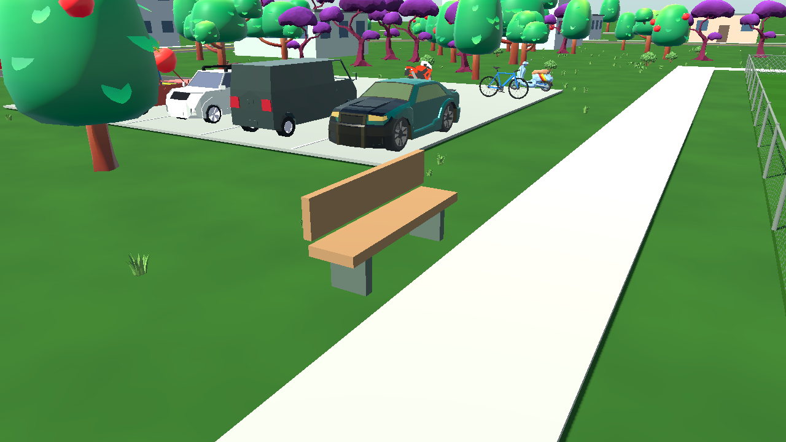

# No9: Day One

### Your first trial. Your first contract. Your story on the pitch.

**A football career begins with a chance. What you do with it is up to you.**

Offline player career · Real football competitions · Touch-first matches · Native 3D development

 

**[Explore the game](#the-footballer-is-you) · [See the screenshots](#official-game-snapshots) · [Public releases](https://github.com/florinhangu/Footballer/releases)**

## The footballer is you

**No9: Day One** is a football player-career game built for mobile. You are not the club manager watching from the sidelines. You create a footballer, earn your first opportunity at a trial, sign a contract, train for your place in the squad and live with the consequences of every match and every season.

Start young. Find a team willing to give you a chance. Grow your abilities, earn minutes, make the most of the ball and decide where your career will go. Beyond your own pitch, leagues keep moving: tables change, clubs earn promotion or face relegation, cup campaigns continue and international opportunities emerge.

The game is designed around **offline progression and local saves**. The main career experience currently plays matches in **2D**. A separate, interactive **native 3D** development experience already includes footballers, training, facilities and demonstration matches, with full career integration as a future goal.

## The experience today

| Your journey | On the pitch | The football world |
| :-- | :-- | :-- |
| Create your player and start at youth trials | Live 2D matches with football AI and match officials | Domestic leagues, cups and changing tables |
| Compete for contracts and a starting place | Tap, double tap and swipe controls | Regional divisions, play-offs and promotion battles |
| Develop attributes through training and recovery | Passing, crossing, shooting, challenges and set pieces | International club and national-team competitions |
| Follow energy, form, club life and history | Sprint and energy reserves tied to player abilities | Thousands of clubs across six geographic regions |
| Track your club, fixtures, career and trophies | Native 3D practice and match demonstrations | A world that continues through successive seasons |

### From the first trial to the next season

Your career begins by defining a player: position, preferred foot, country and footballing identity. Youth trials provide the first test. Contract offers open the door to a club, where every week brings another training decision, upcoming fixture, possible injury or new challenge.

Your profile keeps track of skills, contracts, official match history and trophies. Weekly scheduling connects training, recovery, matches and club responsibilities. The **60-week season structure** keeps domestic and international football moving in the same career.

## Tap. Swipe. Play.

On the career pitch, matches unfold in real time. Team-mates and opponents use AI to make runs, support each other, defend and respond to game situations. You influence the game through the footballer you control.

| Gesture | Action |
| :-- | :-- |
| **Tap an open area** | Move or dribble there while in possession |
| **Quick double tap** | Sprint with the ball toward the selected point |
| **Swipe toward a team-mate** | Play a pass |
| **Long swipe toward a team-mate** | Deliver a longer / aerial ball |
| **Swipe toward goal** | Attempt a shot |
| **Tap an opponent in a duel** | Attempt a standing tackle |

**Without the ball, AI manages your footballer's positioning.** You can request a challenge by tapping an opposing player; normal pitch taps do not take over off-ball running.

A separate **SPRINT** reserve and **ENERGY** indicator reflect short bursts of effort and broader match fitness. Pace, acceleration, stamina and remaining energy influence movement and recovery.

### 2D matches — the core of the career

The live 2D match engine covers passing, shooting, dribbling, crossings, pressing, goalkeeper actions, goal kicks, throw-ins, corners, free kicks, penalties, offside, fouls, cards, substitutions and full-time results. Tactical formations, collective movement and player decisions affect how each side plays.

## Train for your next chance

No9 connects training to the footballer you become. The career has **three regular weekly training sessions** and a separate weekly recovery option. Drills develop different abilities while intensity, fatigue and facility quality affect your preparation.

A catalog of **20 interactive exercises** covers ball control, dribbling, passing, shooting, sprinting, crossing, defensive duels, movement without the ball, aerial play, combinations and set pieces. A dedicated training laboratory also lets you practice without changing your career rewards.

The same catalog can be explored in **native 3D training modes**, with a player, independent ball, targets, goals, support players and goalkeepers.

## The world of No9

No9's documented competition catalog contains:

| Football world | Included |
| :-- | --: |
| Associations with domestic competitions | **152** |
| Clubs playable in active domestic leagues | **6,349** |
| Clubs in the extended catalog, including promotion reserves | **7,879** |
| FIFA federations represented for national-team competitions | **211** |

The leagues span **Europe, Africa, Asia, North & Central America, South America and Oceania**. Some countries use a single division; others have two or three active levels, regional groups, multiple stages, championship and relegation splits, or promotion play-offs. Structures vary with the league rather than forcing every country into the same formula.

The football calendar also supports national cups, international club competitions and national-team tournaments: European club football, Libertadores and Sudamericana, North and Central American competitions, Asian and African continental tournaments, Oceanian club football, continental championships and the World Cup.

**Competition formats are adapted to the game's calendar and available club catalog.** Club names and competition references do not imply official affiliation, endorsement or licensing.

## Beyond the touchline

A football career is more than match results. No9 includes a phone, an agent, messages, clubs, training facilities, schedules, equipment, profile and statistics, plus city services and leisure activities. The aim is for your decisions and achievements between matches to feel connected to the player you become on the pitch.

## A 3D future already taking shape

The native Godot 3D environment is a separate, interactive part of the project. It is more than concept art: it includes a footballer with customizable appearance and kit, football animations, ball contact, team movement, goalkeeper actions, an interactive training catalog and playable demonstration football.

### The player

The 3D player has body and face appearance controls, hair, jersey, shorts, socks, boots and native football animations. The dedicated showcase includes movements, passes, shots, headers, challenges, goalkeeper actions and celebrations.

### The training grounds

Five training-base configurations range from a single small pitch to multi-pitch campuses with changing rooms, training buildings, facilities and outdoor environments. Some include a sports hall or a swimming pool. Park-style and mountain stadium environments add surroundings, access roads, fences and match-day facilities.

### Football, stadiums and match presentation

Native 3D demonstrations include **5+1 small-sided play** and **11-versus-11 friendly play** with match officials, team arrivals, substitutions, goals and full-time presentation. They are development and demonstration modes; the main career is not yet a fully integrated 3D career mode.

## Official game snapshots

Every image below comes from the **original No9 game/project snapshots**. All **40 PNG files** have been copied from the game's snapshot collection into this public repository, without replacing them with mock-ups, AI-generated samples or unrelated demonstrations. The snapshots include both the career's 2D interface and the dedicated 3D development modes.

<strong>Career, tactics and the football world — 8 screenshots</strong>

<table>
<tr><td align="center"> Player profile and attributes</td><td align="center"> Individual training choices</td></tr>
<tr><td align="center"> Team tactical setup</td><td align="center"> Club fixtures and career calendar</td></tr>
<tr><td align="center"> World football and national teams</td><td align="center"> International competitions</td></tr>
<tr><td align="center"> European club competition fixtures</td><td align="center"> Match loading and on-screen guidance</td></tr>
</table>

<strong>Matchday — the 2D career pitch — 3 screenshots</strong>

<table>
<tr><td align="center"> Matchday from kick-off</td><td align="center"> Team shape and ball movement</td></tr>
<tr><td align="center"> Live match action near goal</td><td></td></tr>
</table>

<strong>The footballer in native 3D — 4 screenshots</strong>

<table>
<tr><td align="center"> Player model, front view</td><td align="center"> Jersey number and player name</td></tr>
<tr><td align="center"> Player movement</td><td align="center"> Ball mastery and close control</td></tr>
</table>

<strong>Interactive 3D training and match presentation — 16 screenshots</strong>

<table>
<tr><td align="center"> Training briefing</td><td align="center"> On-pitch training</td></tr>
<tr><td align="center"> Full-size demonstration match</td><td align="center"> Training in rainy conditions</td></tr>
<tr><td align="center"> Teams walking onto the pitch</td><td align="center"> Pre-match line-up</td></tr>
<tr><td align="center"> Players getting ready</td><td align="center"> Match official</td></tr>
<tr><td align="center"> Goal celebration</td><td align="center"> Football in the rain</td></tr>
<tr><td align="center"> Wide view of live 3D action</td><td align="center"> Substitution board</td></tr>
<tr><td align="center"> Player coming on</td><td align="center"> Teams on the pitch</td></tr>
<tr><td align="center"> Live ball action</td><td align="center"> Post-match statistics</td></tr>
</table>

<strong>Training grounds, facilities and stadium surroundings — 9 screenshots</strong>

<table>
<tr><td align="center"> Training base, field-side paths</td><td align="center"> Playing fields and parking</td></tr>
<tr><td align="center"> Pitch, hills and surroundings</td><td align="center"> Swimming pool and football campus</td></tr>
<tr><td align="center"> Football goals and fencing</td><td align="center"> Car park and adjacent grounds</td></tr>
<tr><td align="center"> Practice pitches and pathways</td><td align="center"> Sports academy campus seen from above</td></tr>
<tr><td align="center"> Benches, parking and landscape</td><td></td></tr>
</table>

## Where the journey leads

The long-term goal is a footballer's life that feels connected from the first trial to the biggest matches: a living competitive world, meaningful player growth and a match experience driven by football logic.

Next priorities include integrating the existing 3D presentation directly into career fixtures and results, refining player and goalkeeper animation, improving match atmosphere and stadium life, expanding the experience around contracts and club relationships, and optimizing loading and performance on real mobile devices.

**Current status:** active development. The Godot project currently has an Android export configuration; **iOS is a target platform**, not an announced or verified public release. The existence of development scenes and screenshots does not establish a completed mobile build.

## Public builds

Follow the [Footballer Releases page](https://github.com/florinhangu/Footballer/releases) for public APKs when they are published. The release page is the authoritative place to check availability; a snapshot or feature description is not proof of an available download.

---

## Credits

**Created and directed by Florin Hangu.** ChatGPT and Codex have assisted with research, implementation and development iteration.

No9 is built with [Godot Engine](https://godotengine.org/) and benefits from open-source tools, assets and community work. Credits and licensing information are documented in the [full Credits & Attribution](docs/CREDITS.md).

| Contributor / community | Contribution |
| :-- | :-- |
| [Godot Engine](https://godotengine.org/) and its contributors | Game engine, scripting and runtime |
| Elissa Moeller and the [Humanizer community](https://github.com/NitroxNova/humanizer) | Native character creation tooling |
| [MakeHuman Community](https://www.makehumancommunity.org/) | Related character ecosystem and resources |
| [Quaternius](https://quaternius.com/) | Nature and environment assets |
| [Poly Haven](https://polyhaven.com/) | Natural textures and reference assets |
| [Poly Pizza](https://poly.pizza/) and individual pack creators | Environmental models and props |
| [Kenney](https://kenney.nl/), Rgsdev and other asset creators | Modular scenery and vehicles |
| [Tabler Icons](https://github.com/tabler/tabler-icons) and [Flag Icons](https://github.com/lipis/flag-icons) contributors | Icons and flag resources |
| Independent music, sound-effect and font creators | Soundtrack, football atmosphere, interface and kit typography |

Individual asset licenses and any additional attribution requirements remain applicable. Trademarks and organization names belong to their respective owners; No9 is an independent project and is not officially licensed or endorsed by those football bodies.

## Thanks

Thanks to the Godot and football-game-development communities, open-source maintainers, artists, testers and everyone sharing expertise that makes independent game development possible. And thanks to everyone following the project and helping shape the football experience.

**Your first contract is only the beginning.**
