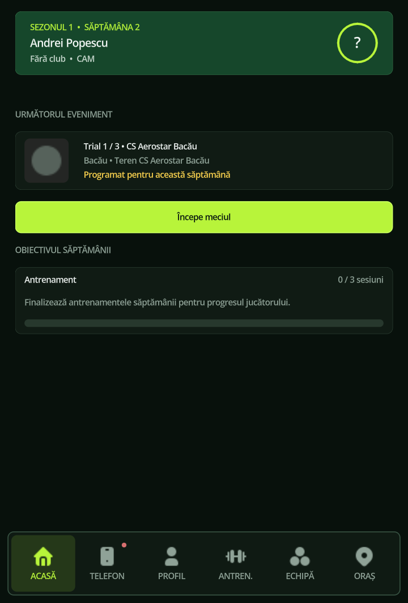
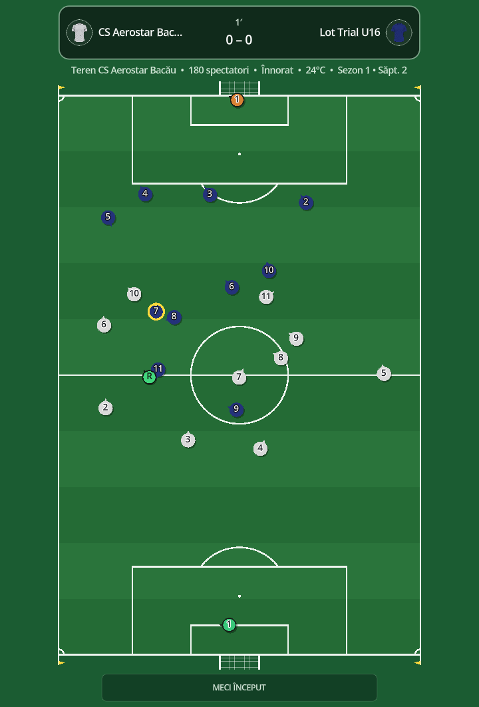

# No9: Day One
### Your first trial. Your first contract. Your story on the pitch.

**A football career begins with a chance.**

Offline player career · Tap & swipe football · Clubs, seasons and competitions · Native 3D in development

[The game today](#the-game-today) · [Touch controls](#tap-swipe-play) · [Latest development](#latest-development--13-october-2026) · [3D development](#the-next-chapter--3d) · [Public builds](https://github.com/florinhangu/Footballer/releases) · [Credits](#credits--thanks)

## A career with your name on it

You are the footballer. Create your identity, choose your position and career country, attend trials and work toward your first club contract. Then build your place in the team through preparation, performances and the decisions you make between matches.

**No9: Day One** is an offline football player-career game. Training, recovery, equipment, club life and fixtures share the same weekly progression. Around your player, leagues develop, cup rounds advance, clubs change divisions and international qualification opens new opportunities. Your career is saved locally.

The current career uses **2D matches with tap and swipe controls**. Native 3D players, training exercises, facilities and match demonstrations are available in dedicated development pages. Bringing that presentation into the complete career remains the next stage.

## The game today

| System | Current experience |
| --- | --- |
| **Player career** | Create a footballer, choose position and preferred foot, attend trials, earn a contract and advance week by week |
| **Local saves** | Continue from your saved career |
| **2D football** | Tap and swipe matches with team AI, goalkeepers, a referee, football restarts, score and clock |
| **Sprint and energy** | Double-tap sprint in possession, with live sprint-reserve and energy bars linked to player abilities |
| **Training and recovery** | Interactive exercises, attribute development and weekly energy management |
| **Club life** | Team information, tactics, fixtures, standings and equipment |
| **Profile and history** | Attributes, contracts, official match history and trophies |
| **Football world** | Domestic leagues and cups, promotion/relegation, continental club competitions and national teams |
| **Phone and city** | Messages, agent interactions and the existing service pages |

<table>
<tr><th>Your first opportunity</th><th>The match</th></tr>
<tr>
<td></td>
<td></td>
</tr>
</table>

*Existing career captures committed on 4 October 2026. Screenshots show Romanian UI; this presentation is in English. Individual APKs may contain different development snapshots.*

## Tap. Swipe. Play.

**Match control is exclusively tactile: tap and swipe.**

| Gesture | Match action |
| --- | --- |
| **Tap the pitch** | Run and dribble toward the selected point while in possession |
| **Quick double tap nearby** | Sprint toward the selected point while in possession |
| **Swipe toward a teammate** | Pass |
| **Long swipe toward a teammate** | Longer / aerial delivery |
| **Swipe toward the goal** | Shoot |
| **Tap an opponent in a duel situation** | Attempt a challenge |

The gesture and football context determine the action. **Without the ball, AI controls your positioning; tapping an opponent requests a standing tackle.** Pitch taps and swipes do not take over off-ball movement.

While in possession, two nearby taps within **300 ms** request sprint. A new single tap returns to normal running. When the human-controlled player has possession and stands still, live play pauses so you can choose the next move.

The **SPRINT** bar shows the short-burst reserve; **ENERGIE** shows the player's existing energy. Speed and acceleration influence movement, while stamina influences sprint duration, energy cost and reserve recovery. Low energy reduces sprint performance. Reserve recovery does not refill career energy, and paused simulation does not advance either resource.

Keyboard shortcuts and optional action buttons shown in development pages are testing controls. Normal game menus provide navigation outside live play.

## A football world that keeps moving

The current catalog documentation reports **152 associations with domestic competitions**, **6,349 playable clubs in active leagues**, **7,879 clubs including inactive promotion reserves**, and **211 FIFA national-team federations**.

The career calendar spans **60 weeks per season**. Countries can use round-robin seasons, regional groups, championship/relegation splits and promotion play-offs. Romania's multi-level pyramid, Argentina's tournament phases, Moldova's mixed qualification group, Australia's league/finals structure and New Zealand's regional route give careers different paths.

Domestic cups connect to continental qualification. International football includes European, American, Asian, African and Oceanian club competitions, plus continental and world tournaments for national teams.

**These are No9's implemented competition formats.** Some structures and participant allocations are adapted to the game's calendar and catalog coverage. Club names do not imply official endorsement or licensing.

## Rules that make the match matter

The shared **AuthorityEngine** determines positioning, decisions, possession, ball movement and results. The 2D experience includes passes, crosses, shots, pressing, support, goalkeeper play, goals, touchlines, corners, goal kicks, free kicks, penalties, offside, fouls, cards, substitutions and changing ends.

A match uses **90 real seconds per half**, with accelerated football movement. The native 3D demonstrations consume the same football authority, with a **1.75× movement tempo** and their own visual presentation.

This shared foundation lets the 3D work present the same decisions and rules while the career integration develops.

## Train with a purpose

The career provides **three regular training sessions per week** and **one separate weekly recovery**. Exercise intensity affects energy use, while the club's training base influences recovery.

The **20-exercise catalog** covers control, passing, shooting, crossing, running, sprinting, positioning, combinations, through balls, set pieces, tackling, interception, aerial play, heading, agility and endurance.

All 20 catalog entries also have native 3D test routes. They reuse the existing exercise definitions, four attempts and scoring. Test results remain separate from career rewards.

## Latest development — 13 October 2026

This presentation was reviewed on **13 October 2026** against the latest No9 main-branch update, source snapshot **f7e6b4b**.

The 13 October update adds possession-only sprint and live effort bars to the shared match authority and native free-training sandbox. The earlier 12 October environment work remains in the same source:

| Area | What the latest source contains |
| --- | --- |
| **Sprint controls** | Single tap for normal running; nearby rapid double tap for sprint while in possession. Off-ball positioning remains under AI, with opponent-tap tackling |
| **Live effort HUD** | Separate sprint reserve and energy bars, driven by simulation state, player abilities and real seconds rather than match-tempo multipliers |
| **Pitch grass** | Short 3D blades, two mowing shades, painted-line handling and denser detail for close, low cameras |
| **Goals and nets** | Separate portable training-goal and stadium-goal geometry; ball contact drives net deformation and a soft rebound response |
| **Stadium scoreboards** | Physical score panels with separate home/away headings that follow the score digits |
| **Goalkeeper equipment** | Gloves and long sleeves attached to the native player's animated skeleton |
| **Player actions** | Three additional warm-up previews: quick footwork, lateral steps and lunges, bringing the showcase selector to **69 actions** |
| **Training atmosphere** | Animated practice groups on secondary pitches, including warm-ups, juggling, dribbling and passing |
| **Facilities and access** | Refined gates, connected walking routes, service-building access and surrounding environment assets |
| **Match presentation** | Updated substitution handling, post-match statistics and team/reserve exit presentation |

These entries describe implementations in the development source. They do not establish a new public APK, a completed 3D career release or measured Android performance.

## The next chapter — 3D

The native 3D area is already interactive in development builds. Its player models, drills, facilities and match demonstrations are being prepared for integration into the main career.

### The player

Humanizer-based geometry and skeletons support independent body, face, skin, eye, hair and kit customization in the test environment. Movement, football actions and goalkeeper poses use native 3D players.

The animation showcase now offers **69 selectable action previews**, including movement, passes and shots on both feet, receptions, headers, tackling, throw-ins, goalkeeper distributions, saves, celebrations and the three new warm-ups.

Goalkeepers have dedicated gloves and long sleeves. Kit handling keeps shirt, shorts and socks separate; jersey names and numbers follow the animated player.

### Five training bases

The five facilities remain separate layouts:

| Facility | Pitch layout |
| --- | --- |
| **Original base** | One pitch |
| **Classic base** | Two pitches |
| **Premium campus** | One large pitch and two small pitches |
| **Sports academy** | Two large pitches and two small pitches |
| **Performance centre** | One large pitch, two small pitches and one covered small pitch |

Changing rooms, storage, sports halls, parking and other amenities vary by facility. Individual campuses include pools. The latest access work joins paths to actual building entrances and places pitch gates beside the goals.

On multi-pitch campuses, secondary fields can host decorative training groups. Their warm-ups and ball exercises add activity to the surroundings without running additional competitive matches.

### Stadiums and their surroundings

The development area includes **two original stadium scenes and 14 configured variants**:

| Family | Variants |
| --- | --- |
| **Urban — seven** | Residential, compact neighbourhood, industrial, green city, Mediterranean, Nordic and outskirts |
| **Mountain — seven** | Alpine village, valley town, resort, rural, compact town, high plateau and wooded valley |
| **Original scenes — two** | Park stadium and mountain stadium |

Full-size test pitches measure **105 × 68 m**, with **7.32 × 2.44 m** goal openings. Benches, changing rooms, fences, gates, vegetation, roads and surrounding buildings give each venue a setting.

Physical scoreboards belong to stadium environments. Their home and away headings remain centred over the corresponding score, including two-digit scores.

The latest source adds short pitch-grass geometry while retaining the two mowing shades and visible white markings. Close-camera density is limited to a local detail area. Grass geometry and its current visibility settings still need visual and device validation.

Portable training goals use a cage shape; stadium goals use tensioned box nets. A shared soft-contact response handles the ball inside the net, and the visual ripple starts at the contact point.

The development asset collection has also expanded with Poly Haven grass, surface textures and an HDRI, plus Poly Pizza city and modular-train packs. Collection availability does not mean every asset is placed in a current scene: the reviewed world still uses its procedural cloud sky.

No new verified stadium capture is published in this update.

### Matches, officials and the final whistle

Native demonstrations support small-sided **5+1** and full-size **11v11** football. Switchable broadcast and ball-follow cameras present the shared match simulation.

The presentation includes team walk-in, line-up, a native referee, half-time, changing ends, goal celebrations, benches and substitutions. The fourth official displays the outgoing number in red and the incoming number in green. Incoming and outgoing players can be visible together during a substitution.

The latest source extends queued substitution presentation and uses the shared match-summary panel after the final whistle. Team and reserve exit presentation can continue while the result remains visible.

An official-fixture interface exists for career integration. The current public description continues to distinguish the working 2D career from the native 3D test area; demonstration matches do not write career results.

Loading prepares actors, materials and initial rendered frames before showing the 3D scene. Smoothness during expensive preparation remains a verification target.

## From GameCore to Day One

**Created and directed by Florin Hangu, with ChatGPT and Codex assisting implementation, research and iteration.**

The preserved Git history begins on **26 September 2026**, with the initial GameCore import and integration of the recorded histories. Work before Git is not dated by that record.

| Recorded period | Development |
| --- | --- |
| **26 September** | GameCore enters Git; shared world state and collective tactical AI |
| **Late September – early October** | Club catalogs, competition structures, equipment experiments and imported-model work |
| **7–9 October** | Humanizer players, native training exercises, appearance tests and editable previews |
| **10–11 October** | Shared-authority 3D demonstrations, officials, benches, loading and cameras |
| **12 October** | Public Footballer presentation; expanded environments, grass, goals, equipment and match presentation |
| **13 October** | Possession-only double-tap sprint, live effort HUD, focused desktop regressions and a complete repository inventory/source audit |

The next stage is to connect the native 3D work to the player's complete career, with readable touch interaction, reliable loading and performance measured on Android.

## What has been verified

The sprint update passed **190 checks with zero failures** in four focused desktop runs with Godot 4.7.2: sprint/energy (39), pointer input (9), existing gestures (13) and match integrity (129). These checks cover resource consumption and recovery, player abilities, possession-only controls, real-second rates, the HUD and the sprint state in the 3D presentation buffer. These are isolated automated code checks; the sprint update has not been verified in a played match in the complete game or on Android.

The figures below are **historical desktop results recorded in project documentation**. They were not rerun for this README and do not validate every current change:

| Recorded scenario | Reported result |
| --- | --- |
| Autonomous 3D demo, 10 October, 90 seconds | 31 passes, 15 shots, eight ground goalkeeper distributions; **1–1** |
| Official-AI demo, 11 October, 90 seconds | 11 passes, seven crosses, four shots, 14 headers, 12 received passes and seven goalkeeper distributions; **1–0** |
| Native animation library comparison, earlier 66-action baseline | **7,685 checks / 0 failures** |
| Focused shared-authority/presentation integration | **684 checks / 0 failures** |

The latest tree contains focused regression scripts for net contact, multiple substitutions, stadium scoreboards, single-base access and grass rendering. Their presence is not a recorded passing run.

A previous GTX 1050 Compatibility-renderer measurement with 22 players and a native referee reported approximately **29.8 FPS median**. It predates the latest changes and does not establish Android frame rate.

Broader AI suites have recorded failures. Controlled scenarios and individual simulated matches do not establish overall balance or complete readiness.

[Verification evidence and remaining work →](docs/VERIFICATION.md)

## Beyond the scoreboard — the No9 promise

An ordinary training day should feel connected to the next match. A performance should matter to your footballer. A new club should feel like a new chapter.

**Earn your place.** Build the story through preparation, performances and opportunities.

**Make football readable.** Keep touch input clear, movement visible and rules coherent.

**Let the world remember.** Carry the consequences of matches, contracts and seasons into the career.

## Public builds

[Footballer Releases](https://github.com/florinhangu/Footballer/releases) is the public build-download hub.

**No published release or APK attachment was present at the 13 October 2026 check.**

The current development export targets Android **ARM32 and ARM64** and names **0.A1.33**. The application configuration still names **0.A1.16**. The version metadata needs reconciliation before a verified public release; an export filename does not prove an APK was built or tested.

No iOS export preset or verified iOS release was found in the reviewed source.

Future releases should identify the exact version, tested devices, included game and development modes, known issues and save compatibility. See the [release guide](docs/RELEASES.md).

[Report an issue](https://github.com/florinhangu/Footballer/issues) · [Browse public builds](https://github.com/florinhangu/Footballer/releases)

---

**Your first contract is only the beginning.**

*Footballer is the public presentation and release hub. The private game source is maintained separately. Page updated 13 October 2026 from No9 source snapshot f7e6b4b.*

## Powered by

<table>
<tr>
<td align="center">
 
<a href="https://godotengine.org/"><b>Godot Engine</b></a> 
Game engine · GDScript · Compatibility renderer
</td>
<td align="center">
 
<a href="https://chatgpt.com/"><b>ChatGPT</b></a> &amp; <a href="https://openai.com/codex/"><b>Codex</b></a> 
Development, research and creative assistance
</td>
</tr>
</table>

Godot runs the game; ChatGPT and Codex assist its development. No9 remains an independent project.

## Credits & Thanks

Thank you to the creators and communities who make these tools and assets available.

| Contribution | Creator / source |
| --- | --- |
| **Godot Engine** | Juan Linietsky, Ariel Manzur and the [Godot contributors](https://github.com/godotengine/godot) |
| **Humanizer** | Elissa Moeller and the [Humanizer community](https://github.com/NitroxNova/humanizer) |
| **MakeHuman / MPFB content** | [MakeHuman Community](https://www.makehumancommunity.org/), Data Collection AB, Joel Palmius and Jonas Hauquier |
| **Stylized Nature MegaKit** | [Quaternius](https://quaternius.com/) |
| **Nature & Terrain — Free Edition** | [Avramania](https://www.avramania.com/) |
| **Modular prototyping / vehicle packs** | Raphael Gonçalves, [Rgsdev](https://www.patreon.com/rgsdev) |
| **Stylized Grass meshes and shader** | [StayAtHomeDev](https://stayathomedev.itch.io/stylized-grass-shader) |
| **Poly Haven grass and surface resources** | [Poly Haven](https://polyhaven.com/); Grass Medium 01 by Rob Tuytel and Rico Cilliers; Suburban Soccer Park by Dimitrios Savva and Jarod Guest — CC0 |
| **City Pack asset collection** | [Poly Pizza](https://poly.pizza/bundle/City-Pack-kJqRAIGsw0): J-Toastie, Zsky, Quaternius, Kay Lousberg, Poly by Google, dook, Danni Bittman, Jens Kull, jeremy and Zack Huang — asset-specific CC BY 3.0 / CC0 |
| **Modular Train Pack asset collection** | [Quaternius via Poly Pizza](https://poly.pizza/bundle/Modular-Train-Pack-jYEybkFVr1) — CC0 |
| **Tabler Icons** | Paweł Kuna and the [Tabler contributors](https://github.com/tabler/tabler-icons) |
| **Flag Icons** | Panayiotis Lipiridis and [flag-icons contributors](https://github.com/lipis/flag-icons) |
| **Jersey fonts** | Dharma Type; Anton, Oswald and Barlow project authors; Indian Type Foundry |

<b>Editor tools and additional acknowledgements</b>

| Tool | Creator / source |
| --- | --- |
| Road Generator | Moo-Ack! Productions / TheDuckCow — [source](https://github.com/TheDuckCow/godot-road-generator) |
| RichText3D | Matias Szylkowski — [source](https://github.com/mszylkowski/rich-text-3d-godot) |
| Material Layers | Foyezes — [source](https://github.com/Foyezes/Godot-Material-Layers-Legacy) |
| Ragdoll Generator | Manik Sharma — [source](https://github.com/Manik2607/auto-ragdoll) |
| Low Poly Terrain Builder | Fabian S / 78sForge — [source](https://github.com/78sForge/LowPolyTerrainBuilder) |
| M.A.V.S | Millu30 / Gidan — [source](https://github.com/Dente222/MAdvanced-Vehicle-Controller) |
| Weather System (Lite) | Sean Elovirta |

Tools and packs present in the development repository are acknowledged here even when not active in every scene.

<b>New collection attributions — 12 October update</b>

The following source records accompany the newly reviewed collections. Assets may be adapted in scale, materials, placement or geometry for No9; inclusion in a collection does not mean every item is used in a scene.

### Poly Haven

- **[Grass Medium 01](https://polyhaven.com/a/grass_medium_01)** — Rob Tuytel (photography), Rico Cilliers (modeling); [CC0 1.0](https://creativecommons.org/publicdomain/zero/1.0/).
- **[Suburban Soccer Park](https://polyhaven.com/a/suburban_soccer_park)** — Dimitrios Savva (photography), Jarod Guest (processing); CC0 1.0. Included as an HDRI resource; the reviewed world uses a procedural sky.

### Poly Pizza City Pack

- [Flower Pot](https://poly.pizza/m/XOT4ajEFjU) — Zsky; CC-BY 3.0.
- [Flower Pot](https://poly.pizza/m/Kgt363WkKd) — Zsky; CC-BY 3.0.
- [Debris Papers](https://poly.pizza/m/MujITy1NRR) — Quaternius; CC0 1.0.
- [Mailbox](https://poly.pizza/m/9gbHlg1IlY) — J-Toastie; CC-BY 3.0.
- [Traffic Light](https://poly.pizza/m/lg9AKWejnF) — Quaternius; CC0 1.0.
- [Manhole Cover](https://poly.pizza/m/S6aGVNF1Iz) — J-Toastie; CC-BY 3.0.
- [Bus stop sign](https://poly.pizza/m/ECdbKwxoLa) — dook; CC-BY 3.0.
- [Fence Piece](https://poly.pizza/m/Y6D3Sbc85w) — J-Toastie; CC-BY 3.0.
- [Fence End](https://poly.pizza/m/tQ5zhPd5UC) — J-Toastie; CC-BY 3.0.
- [Floor Hole](https://poly.pizza/m/FbJAtOQ8pb) — J-Toastie; CC-BY 3.0.
- [Cone](https://poly.pizza/m/WoXpAJT0oD) — J-Toastie; CC-BY 3.0.
- [Tree](https://poly.pizza/m/6pwiq7hSrHr) — Poly by Google; CC-BY 3.0.
- [Gb Blank](https://poly.pizza/m/bBFgKEQoUq) — J-Toastie; CC-BY 3.0.
- [Greenhouse](https://poly.pizza/m/exys3emjr1) — J-Toastie; CC-BY 3.0.
- [RB Blank](https://poly.pizza/m/gjq5Qii72b) — J-Toastie; CC-BY 3.0.
- [Road Bits](https://poly.pizza/m/5BPCPOycxC) — Kay Lousberg; CC0 1.0.
- [Building Green](https://poly.pizza/m/FmjsfA1eHY) — J-Toastie; CC-BY 3.0.
- [Pizza Corner](https://poly.pizza/m/78W2Ab2Uvt) — J-Toastie; CC-BY 3.0.
- [Bench](https://poly.pizza/m/dfDUkVthkMT) — Danni Bittman; CC-BY 3.0.
- [Fire Exit](https://poly.pizza/m/ugX9DZ0wlI) — J-Toastie; CC-BY 3.0.
- [Fence](https://poly.pizza/m/ZSQMyIqPTz) — J-Toastie; CC-BY 3.0.
- [Building Red Corner](https://poly.pizza/m/9JuFwnivP0) — J-Toastie; CC-BY 3.0.
- [Building Red](https://poly.pizza/m/lbNz2dClar) — J-Toastie; CC-BY 3.0.
- [Brown Building](https://poly.pizza/m/fGKIlWGDNH) — J-Toastie; CC-BY 3.0.
- [Air conditioner](https://poly.pizza/m/4m3lja-ZCkA) — Poly by Google; CC-BY 3.0.
- [Dumpster](https://poly.pizza/m/PKsbolkZSr) — Quaternius; CC0 1.0.
- [Trash Can](https://poly.pizza/m/PEtRDeGyg0) — Zsky; CC-BY 3.0.
- [trah bag grey](https://poly.pizza/m/axTuG36RXnN) — Jens Kull; CC-BY 3.0.
- [Roof Exit](https://poly.pizza/m/GEB4pWBI8l) — J-Toastie; CC-BY 3.0.
- [Big Building](https://poly.pizza/m/AVCS8jUd2l) — Quaternius; CC0 1.0.
- [Rock band poster](https://poly.pizza/m/fTsh4nKZ9iK) — jeremy; CC-BY 3.0.
- [Yellow Post-it](https://poly.pizza/m/1-ZStsi8S91) — Zack Huang; CC-BY 3.0.
- [Box](https://poly.pizza/m/ykZ23x9d6p) — Kay Lousberg; CC0 1.0.
- [Washing Line](https://poly.pizza/m/nGU4m9V7ez) — J-Toastie; CC-BY 3.0.
- [ATM](https://poly.pizza/m/p4U0tSF5WN) — J-Toastie; CC-BY 3.0.
- [Power Box](https://poly.pizza/m/WFVjj4vnGg) — J-Toastie; CC-BY 3.0.
- [Planter & Bushes](https://poly.pizza/m/wn85Xr9lM3) — J-Toastie; CC-BY 3.0.
- [Fire hydrant](https://poly.pizza/m/eNPaSEPrst8) — Poly by Google; CC-BY 3.0.
- [Animated Woman](https://poly.pizza/m/nIItLV9nxS) — Quaternius; CC0 1.0.
- [Animated Woman](https://poly.pizza/m/qJ2gsTUBHL) — Quaternius; CC0 1.0.
- [Animated Woman](https://poly.pizza/m/9kF7eTDbhO) — Quaternius; CC0 1.0.
- [Stop sign](https://poly.pizza/m/60GyU9CdZ9r) — Poly by Google; CC-BY 3.0.
- [Billboard](https://poly.pizza/m/3ALIEkWNbgR) — Poly by Google; CC-BY 3.0.
- [Adventurer](https://poly.pizza/m/5EGWBMpuXq) — Quaternius; CC0 1.0.
- [Man](https://poly.pizza/m/HMnuH5geEG) — Quaternius; CC0 1.0.
- [Motorcycle](https://poly.pizza/m/dse64pqMKAR) — Poly by Google; CC-BY 3.0.
- [Bus](https://poly.pizza/m/4CPpvEmrMoF) — Poly by Google; CC-BY 3.0.
- [Bicycle](https://poly.pizza/m/19VoUuA2pcN) — Poly by Google; CC-BY 3.0.
- [Van](https://poly.pizza/m/aT_24cDaW1a) — Poly by Google; CC-BY 3.0.
- [Pickup Truck](https://poly.pizza/m/qn4grQgHm8) — Quaternius; CC0 1.0.
- [Sports Car](https://poly.pizza/m/1mkmFkAz5v) — Quaternius; CC0 1.0.
- [Car](https://poly.pizza/m/unqqkULtRU) — Quaternius; CC0 1.0.
- [Police Car](https://poly.pizza/m/BwwnUrWGmV) — Quaternius; CC0 1.0.
- [Car](https://poly.pizza/m/Cz6yDaUcM9) — Quaternius; CC0 1.0.
- [Sports Car](https://poly.pizza/m/Gzj704DXdr) — Quaternius; CC0 1.0.
- [SUV](https://poly.pizza/m/xsMtZhBkxL) — Quaternius; CC0 1.0.
- [Bus Stop](https://poly.pizza/m/OWczicNWhO) — Zsky; CC-BY 3.0.

[CC BY 3.0](https://creativecommons.org/licenses/by/3.0/)
[CC0 1.0](https://creativecommons.org/publicdomain/zero/1.0/)

### Poly Pizza Modular Train Pack

The [Modular Train Pack](https://poly.pizza/bundle/Modular-Train-Pack-jYEybkFVr1) is by **Quaternius**, under CC0 1.0. The collection contains straight and curved railway tracks, passenger and locomotive sections, coal/container cargo pieces, cargo wagons, and high-speed front/wagon sections. These are collection resources; a railway gameplay system is not claimed.

[Earlier full credits, asset provenance and bundled license notices →](docs/CREDITS.md)

Godot logo: © 2017 Andrea Calabró, [CC BY 4.0](https://creativecommons.org/licenses/by/4.0/). ChatGPT logo and marks belong to OpenAI; used as development attribution under the [OpenAI brand guidelines](https://openai.com/brand/). [Logo sources →](media/branding/README.md)

