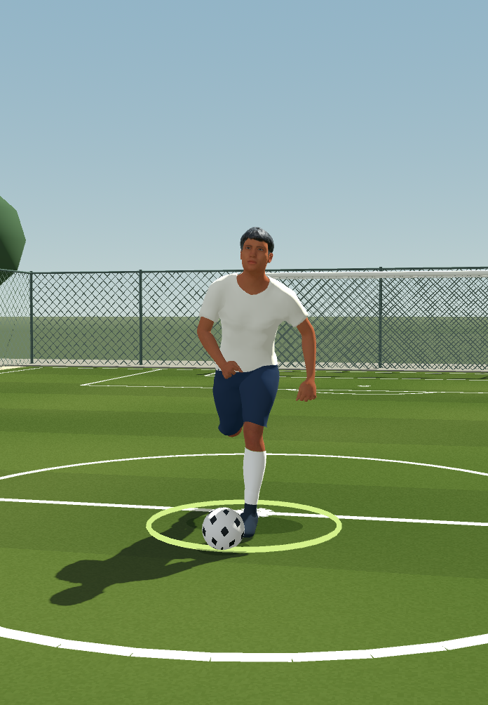
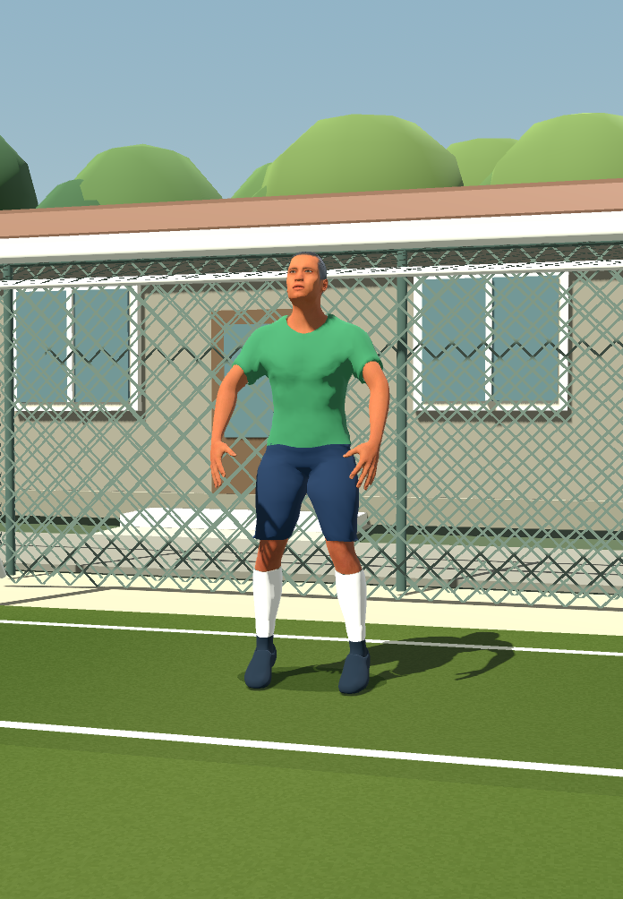
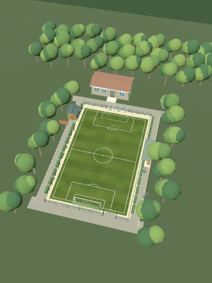
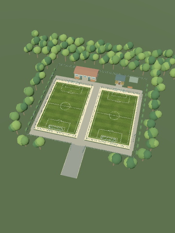
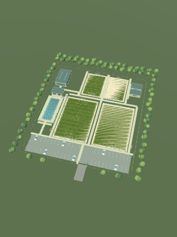
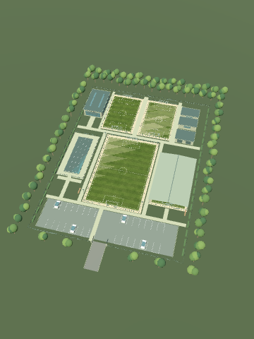
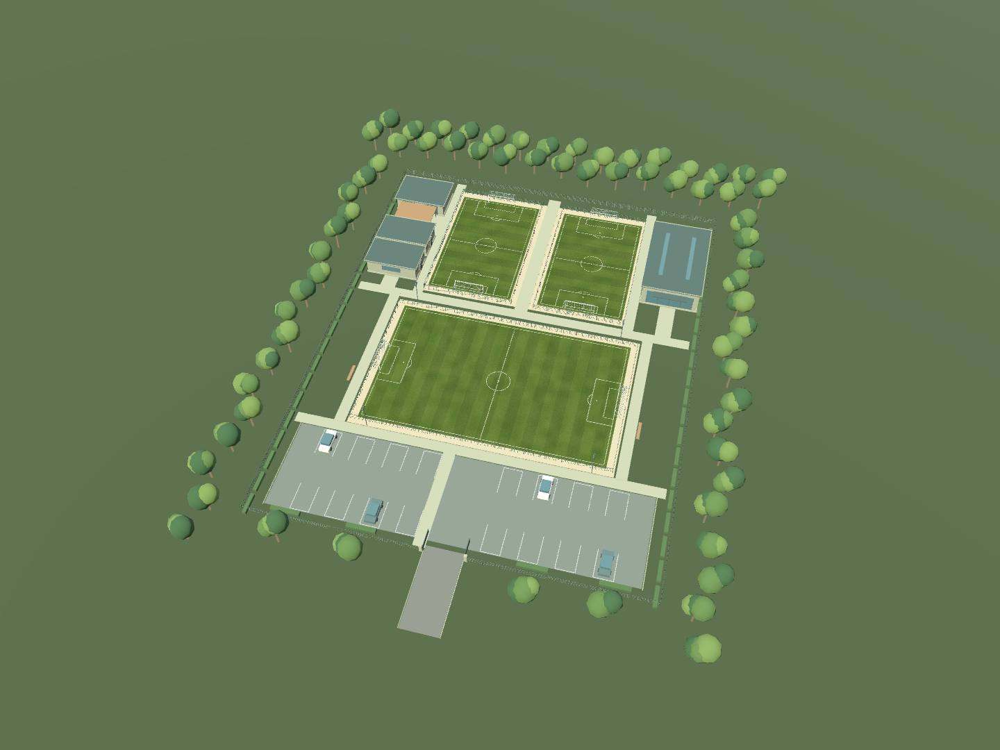

# No9: Day One
### Your first trial. Your first contract. Your story on the pitch.

**A football career begins with a chance.**

Offline player career · Tap & swipe controls · Tactical football · A world of clubs and competitions

[The game today](#available-and-functional) · [Touch controls](#tap-swipe-play) · [What's next](#the-next-chapter--3d) · [Public builds](https://github.com/florinhangu/Footballer/releases) · [Credits](#credits--thanks)

## A career with your name on it

You are the footballer. Create your identity, choose your position and career country, attend trials and work toward your first club contract. Then the weeks begin to matter: training, recovery, the next fixture and the place you are trying to earn in the team.

**No9: Day One** connects the small decisions of a player's week with a wider football world. Clubs play through seasons, tables move, cups advance, teams fight for promotion and international qualification opens new routes. Your career is saved locally.

The existing game is an **offline football career with 2D matches and touch-only match controls**. Native 3D players, training grounds and stadiums are being developed in dedicated test pages for a future chapter.

## Available and functional

These systems exist in the current game. Individual APKs may include different development snapshots.

| System | What you can do |
| --- | --- |
| **Player career** | Create a footballer, select position and preferred foot, enter trials, earn a club contract and progress week by week |
| **Local saves** | Continue your career from your saved progress |
| **2D matches** | Play through tap and swipe, with team AI, a referee, score, clock and football restarts |
| **Training and recovery** | Complete interactive career exercises, improve attributes and manage weekly energy |
| **Club life** | Explore your club, tactics, calendar, league table and equipment |
| **Profile and history** | Follow attributes, contracts, match history and trophies |
| **Football world** | Follow domestic leagues, cups, promotion/relegation and international competitions |
| **Phone and city** | Use the existing messages, agent and city/service pages |

<table>
<tr><th>Your first opportunity</th><th>The match</th></tr>
<tr>
<td></td>
<td></td>
</tr>
</table>

*Existing game captures, last committed on 4 October 2026. The interface shown is Romanian; this public presentation is English.*

## Tap. Swipe. Play.

**Match control is exclusively tactile: tap and swipe.** There are no physical-button, keyboard or on-screen action-button requirements during a match.

| Gesture | Match action |
| --- | --- |
| **Tap the pitch** | Move the controlled player; dribble when in possession |
| **Swipe toward a teammate** | Pass |
| **Long swipe toward a teammate** | Longer / aerial delivery |
| **Swipe toward the goal** | Shoot |
| **Tap an opponent in a duel situation** | Attempt a challenge |

The gesture and match context determine the action. A deliberate interaction rule freezes live play while the human-controlled player holds possession and stands still, giving you time to choose your next move.

**Buttons and keyboard shortcuts visible in development test pages are testing tools. They are not the game's match-control scheme.** Normal menus still provide navigation outside live play.

## A football world that keeps moving

The existing catalog documentation reports **152 associations with domestic competitions**, **6,349 playable clubs in active leagues**, **7,879 clubs including inactive promotion reserves**, and **211 FIFA national-team federations**.

Domestic leagues and cups sit alongside continental club competitions and national-team tournaments. Countries can use round-robin seasons, regional groups, championship/relegation splits and promotion play-offs. The calendar is adapted to the game's 60-week career season.

**Competition rules are the rules implemented by No9.** Some formats deliberately differ from real-world editions. The career world includes Romania's multi-level pyramid, Argentina's separate tournament phases, Moldova's mixed qualification group, Australia's league/finals arrangements and regional New Zealand competitions.

Club names and catalog research do not imply official endorsement or licensing.

## Rules that make the match matter

The shared **AuthorityEngine** runs positioning, decisions, possession and results. The existing 2D match experience includes passing, crossing, shooting, pressing, support, goalkeeper play, goals, touchlines, corners, goal kicks, free kicks, penalties, offside, fouls, cards, substitutions and changing ends.

The match uses **90 real seconds per half**, with accelerated football movement. Career training has its own energy and reward flow; a result in a development test does not grant career progress.

The future 3D presentation is built around that same match authority so that changing the view can preserve the football rules.

## Train with a purpose

The existing career exercises cover ball control, passing, shooting, crossing, running and sprinting, positioning, combinations, through balls, set pieces, tackling, interception, aerial play, heading, agility and endurance.

The career has **three regular training sessions per week** and **a separate weekly recovery**. Exercise intensity affects energy use; the club's training base influences recovery. Preparation and rest connect the current week with your next performance.

The 20-exercise catalog is also being adapted to native 3D in the test area. That future presentation reuses the existing definitions, four attempts and scoring rather than inventing a different training progression system.

## The next chapter — 3D

**The features below are future-facing work developed in dedicated test pages. They are not presented as completed career features.**

### The player

Humanizer-based geometry, skeletons and appearance controls support native player development. The test work includes body/face customization, separate kit handling, grounded movement, goalkeeper actions, football poses and a 66-clip animation showcase.

<table>
<tr><th>Player movement preview</th><th>Goalkeeper preview</th></tr>
<tr>
<td></td>
<td></td>
</tr>
</table>

*The most recent committed player-action captures found in this set: 9 October 2026. These show test-page development, not a new public release.*

### Training bases

Five different facilities are part of the native 3D test environments. The existing variants remain separate layouts.

<table>
<tr><th>Original single-pitch base</th><th>Classic two-pitch base</th></tr>
<tr>
<td></td>
<td></td>
</tr>
<tr><th>Sports academy</th><th>Performance centre</th></tr>
<tr>
<td></td>
<td></td>
</tr>
</table>

**Premium campus**

*Base captures were committed on 9 October; the premium overview was last updated in Git on 11 October 2026. A commit date records when an image entered Git, not necessarily when it was captured.*

The facilities range from compact practice grounds to campuses with multiple pitches, changing rooms, storage, a sports hall, parking and other amenities. Individual layouts include pools and a covered small pitch. Fences, paths, vegetation and goals give training a setting beyond an isolated rectangle of grass.

### Stadiums

The 3D tests include two original stadium scenes plus **14 configured variants**:

| Family | Development variants |
| --- | --- |
| **Urban** | Residential, compact neighbourhood, industrial, green city, Mediterranean, Nordic and outskirts |
| **Mountain** | Alpine village, valley town, resort, rural, compact town, high plateau and wooded valley |
| **Original scenes** | Park stadium and mountain stadium |

The full-size test pitch measures **105 × 68 m**, with **7.32 × 2.44 m** goal openings. The scene work includes benches, changing rooms, access gates, neighbourhoods and daylight environments.

Recent stadium captures mentioned by the development notes are stored in local build folders and were not present in the accessible GitHub source or the recent workflow artifacts checked. They will be added when verified captures are available.

### Matches and training in 3D

The test pages exercise small-sided **5+1** and full-size **11v11** matches, broadcast and ball-follow cameras, native players, referees, substitutions, a fourth official and a substitution board.

An official-fixture entry point exists for future integration with the career flow. Test matches and test training remain separate from career results and rewards.

The release target is Android. The current source has an Android APK export for ARM32 and ARM64. No verified iOS release or export preset was found.

## From GameCore to Day One

**Created and directed by Florin Hangu, with ChatGPT and Codex assisting implementation, research and iteration.**

The preserved Git history begins on **26 September 2026**. An initial commit was followed that day by the **“Initial No9 GameCore repository”** import and integration of the histories. The record does not establish when the idea or work before Git began.

Early recorded work concentrated on the tactical foundation: shared world state, coordinated rotations, passing shadows, curved pressure, progression options and reactions to opponents. The project then expanded through club catalogs and competition structures, equipment experiments, native training and the future 3D match presentation.

| Recorded period | Development |
| --- | --- |
| **26 September** | GameCore enters Git; collective tactical AI and world-state work |
| **Late September – early October** | Equipment, imported characters/animations, stadium corrections and competition research |
| **7–9 October** | Character work, native training catalog, editable previews and appearance tests |
| **10–11 October** | 3D demonstrations, shared rules authority, benches, officials, loading and cameras |
| **12 October** | Footballer becomes the English presentation and future public build hub |

The game already has a working career foundation and a broad football world. The next phase is to bring the 3D work into that experience with stable movement, clear touch interaction and dependable mobile performance.

## What the simulations have shown

These are **documented desktop development results**, not tests rerun for this page or Android acceptance results.

| Recorded test scenario | Reported outcome |
| --- | --- |
| Autonomous 3D demo, 10 October, 90 seconds | 31 passes, 15 shots, receptions and tackles on both feet, eight ground distributions; **1–1** |
| Official-AI demo, 11 October, 90 seconds | 11 passes, seven crosses, four shots, 14 headers, 12 received passes, seven goalkeeper distributions; **1–0** |
| Native animation library comparison | **7,685 checks / 0 failures** |
| Focused shared-authority/presentation integration | **684 checks / 0 failures** |

These summaries describe particular test paths and snapshots. Controlled scenarios exercise rare actions; one simulated match is not a balance study. Broader AI suites have recorded failures and remain part of the verification work.

A documented GTX 1050 Compatibility-renderer run with 22 players and a native referee measured approximately **29.8 FPS median**. It does not establish Android performance.

[Verification evidence and remaining work →](docs/VERIFICATION.md)

## Beyond the scoreboard — the No9 promise

**Our editorial north star for the next stages.**

A compelling player career should make an ordinary Tuesday feel connected to Saturday's match. A training result should explain something about your footballer. A new club should feel like a new chapter.

**Earn your place.** Build the story through preparation, performances and opportunities.

**Make football readable.** Keep tap and swipe clear, movement visible and rules coherent.

**Let the world remember.** Carry the consequences of matches, contracts and seasons into the career.

The question for every addition: does it make your footballer's next week more meaningful?

## Public builds

[Footballer Releases](https://github.com/florinhangu/Footballer/releases) is the public build-download hub.

At the publication check, **no release or APK attachment existed**. This presentation does not upload a binary.

The development export preset names **0.A1.33**, while the application configuration still names **0.A1.16**. These must be reconciled before a verified release. The preset filename is not proof of a built or tested APK.

Each future release should identify the exact version, devices tested, included game/test modes, known issues and save compatibility. See the [release guide](docs/RELEASES.md).

[Report an issue](https://github.com/florinhangu/Footballer/issues) · [Browse public builds](https://github.com/florinhangu/Footballer/releases)

---

**Your first contract is only the beginning.**

*Footballer is the public presentation and release hub. The private game source is not published here. Page updated 12 October 2026.*

## Powered by

<table>
<tr>
<td align="center">
 
<a href="https://godotengine.org/"><b>Godot Engine</b></a> 
Game engine · GDScript · Compatibility renderer
</td>
<td align="center">
 
<a href="https://chatgpt.com/"><b>ChatGPT</b></a> &amp; <a href="https://openai.com/codex/"><b>Codex</b></a> 
Development, research and creative assistance
</td>
</tr>
</table>

Godot runs the game; ChatGPT and Codex assist its development. No9 remains an independent project.

## Credits & Thanks

Thank you to the creators and communities who make these tools and assets available.

| Contribution | Creator / source |
| --- | --- |
| **Godot Engine** | Juan Linietsky, Ariel Manzur and the [Godot contributors](https://github.com/godotengine/godot) |
| **Humanizer** | Elissa Moeller and the [Humanizer community](https://github.com/NitroxNova/humanizer) |
| **MakeHuman / MPFB content** | [MakeHuman Community](https://www.makehumancommunity.org/), Data Collection AB, Joel Palmius and Jonas Hauquier |
| **Stylized Nature MegaKit** | [Quaternius](https://quaternius.com/) |
| **Starter Kit City Builder** | [Kenney](https://kenney.nl/) |
| **Nature & Terrain — Free Edition** | [Avramania](https://www.avramania.com/) |
| **Modular prototyping / vehicle packs** | Raphael Gonçalves, [Rgsdev](https://www.patreon.com/rgsdev) |
| **Stylized Grass meshes and shader** | [StayAtHomeDev](https://stayathomedev.itch.io/stylized-grass-shader) |
| **Tabler Icons** | Paweł Kuna and the [Tabler contributors](https://github.com/tabler/tabler-icons) |
| **Flag Icons** | Panayiotis Lipiridis and [flag-icons contributors](https://github.com/lipis/flag-icons) |
| **Jersey fonts** | Dharma Type; Anton, Oswald and Barlow project authors; Indian Type Foundry |

<b>Editor tools and additional acknowledgements</b>

| Tool | Creator / source |
| --- | --- |
| Road Generator | Moo-Ack! Productions / TheDuckCow — [source](https://github.com/TheDuckCow/godot-road-generator) |
| RichText3D | Matias Szylkowski — [source](https://github.com/mszylkowski/rich-text-3d-godot) |
| Material Layers | Foyezes — [source](https://github.com/Foyezes/Godot-Material-Layers-Legacy) |
| Ragdoll Generator | Manik Sharma — [source](https://github.com/Manik2607/auto-ragdoll) |
| Low Poly Terrain Builder | Fabian S / 78sForge — [source](https://github.com/78sForge/LowPolyTerrainBuilder) |
| M.A.V.S | Millu30 / Gidan — [source](https://github.com/Dente222/MAdvanced-Vehicle-Controller) |
| Weather System (Lite) | Sean Elovirta |

Tools and packs present in the development repository are acknowledged here even when not active in every scene.

[Full credits, asset provenance and license notices →](docs/CREDITS.md)

Godot logo: © 2017 Andrea Calabró, [CC BY 4.0](https://creativecommons.org/licenses/by/4.0/). ChatGPT logo and marks belong to OpenAI; used as development attribution under the [OpenAI brand guidelines](https://openai.com/brand/). [Logo sources →](media/branding/README.md)
