

# No9: Day One

### Your first trial. Your first contract. Your story on the pitch.

**Build a footballer's career, one chance at a time.**

Offline career · Playable 2D and 3D matches · Training · Club and international football

[Your career](#your-career-starts-here) · [Match day](#step-onto-the-pitch) · [Training](#earn-your-place) · [No9Editor](docs/EDITOR.md) · [Downloads](docs/RELEASES.md)

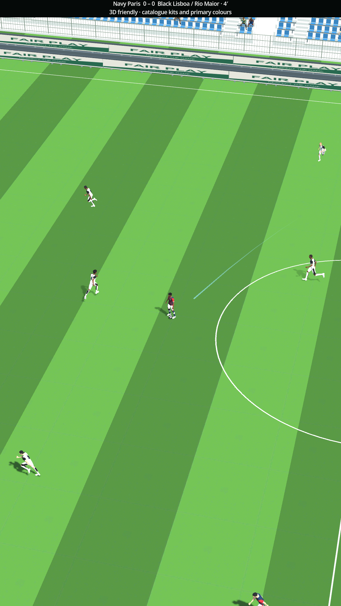
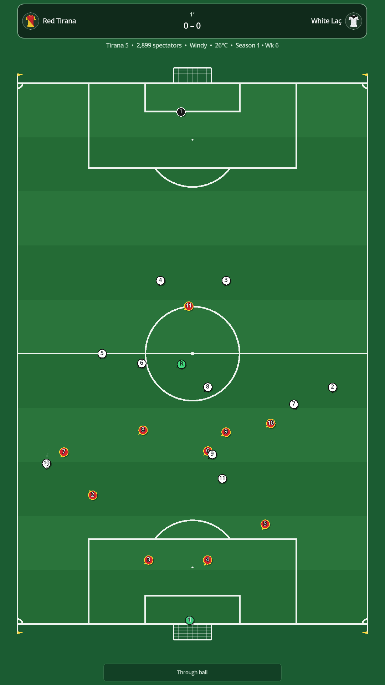

## Your career starts here

Create a young footballer, choose your position and preferred foot, and take your
first chance at a youth trial. Find a club, negotiate a contract and work towards
a place in the team. Your form, fitness and performances shape the opportunities
that follow.

Sit down with the director of football to discuss wages, your place in the squad,
contract length and the club's plans. Original British English conversations let
you weigh up the offer and choose your response.

  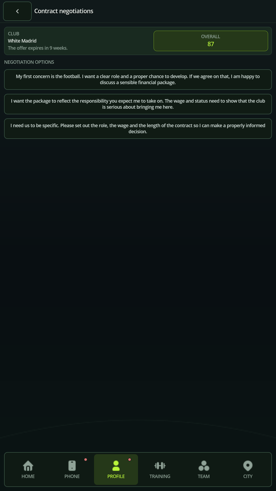

The career follows your player through training weeks, match days, contracts,
transfers, injuries and recovery. Your profile keeps your attributes, appearances,
career history and trophies together. Local saves let you return to the same
career and continue where you left off.

  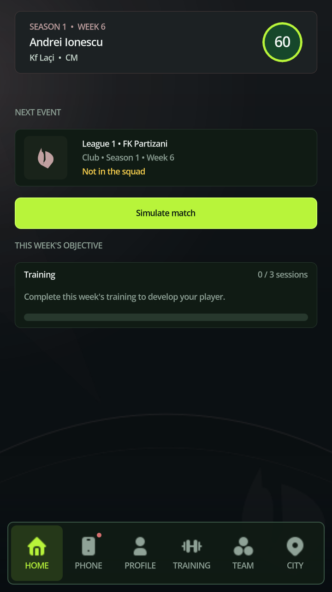
  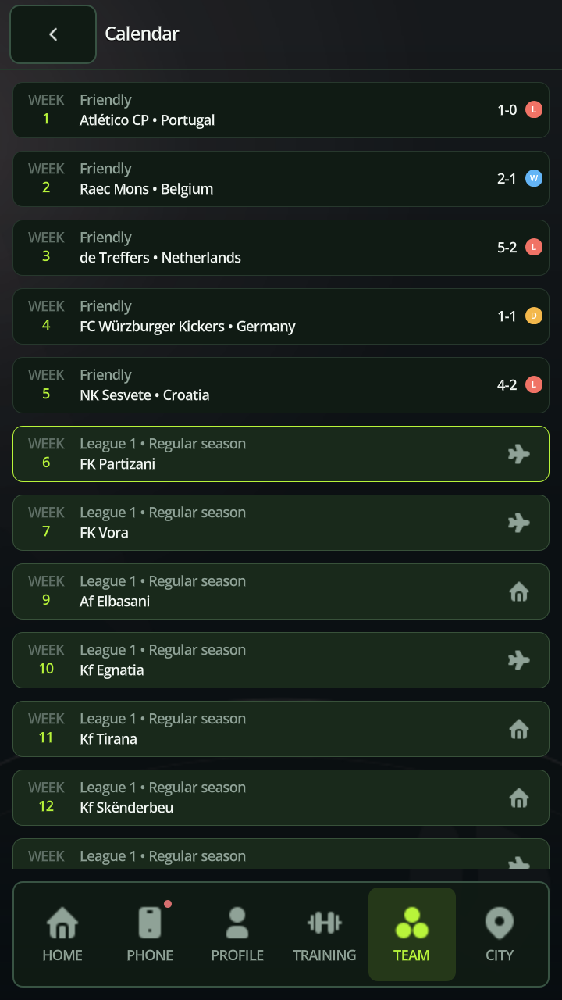
  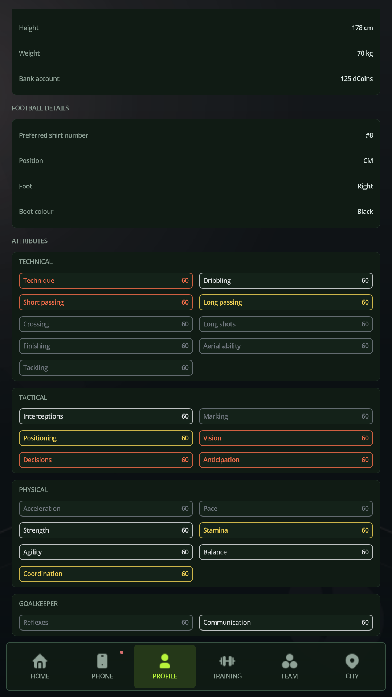

Career moments draw on **1,485 story variants across 30 milestones**, from the
first trial and first-team debut to national-team selection, transfers,
captaincy, trophies and retirement decisions. Original British English scenes
bring the conversations, nerves, celebrations and quieter moments to life.

  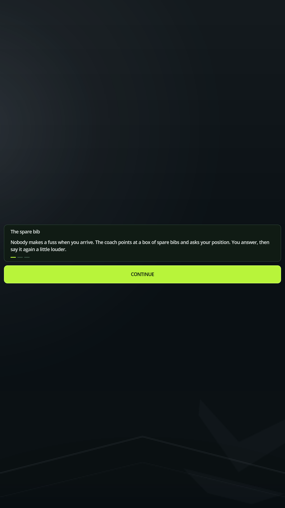

## Step onto the pitch

Play career matches in **2D or 3D**. Make the most of possession with passes,
dribbles, crosses and shots, while team-mates and opponents move around you.
Touch controls connect your decisions to the action, and sprint and energy
reserves make timing your effort part of the match.

Football includes goalkeepers, restarts, set pieces, offsides, fouls, cards and
substitutions. The manager's selection determines your role on match day;
training and form help you earn your minutes. Results and performances become
part of your career.

The 3D view brings players, match officials, home and away kits, spectators,
dugouts and stadiums onto the pitch. Camera and match-speed controls let you
follow the play. Separate 11-a-side friendlies are available for football outside
the career schedule.

## Earn your place

Choose from **20 interactive football exercises** covering ball control, passing,
shooting, movement, sprinting, crossing, defending, aerial play and set pieces.
Regular weekly training develops your player, while recovery helps manage the
demands of the season. Position training gives you another way to shape your role.

Follow technical, tactical and physical attributes as your career develops.
Training performance, effort and the club's facilities all contribute to your
preparation for the next match.

  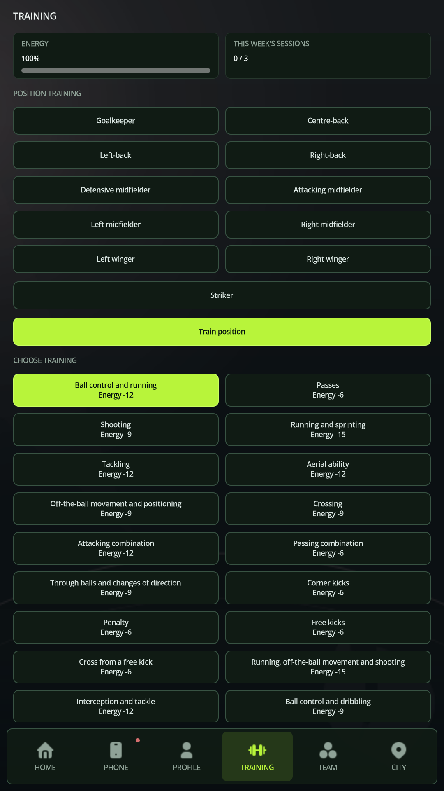
  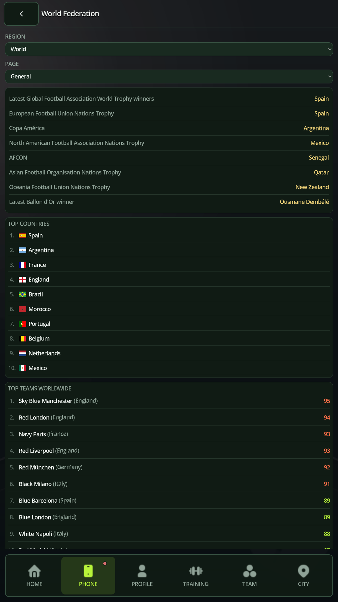

## A football world around you

Clubs and competitions span **Europe, Africa, Asia, North and Central America,
South America and Oceania**. League tables, domestic cups, promotion battles,
relegation and play-offs continue through successive seasons. International club
competitions and national-team football give a career ambitions beyond its own
league.

Use your phone to follow messages, speak to your agent, browse clubs and explore
the wider football world. Away from match day, city activities and leisure games
offer another side of a footballer's life.

## Your club's colours

Home, away and third kits combine independent shirt, shorts and sock designs.
Club palettes reflect current-season sources where documented. Printed names
and numbers and team branding give each side its identity. Choose from 84 original crests, coloured from the club palette.
Twelve original manufacturer marks add another part of each team's identity.
National-team defaults draw on their country flags. Teams receive seasonal kit
editions, with separate colour choices for
the three garments.

  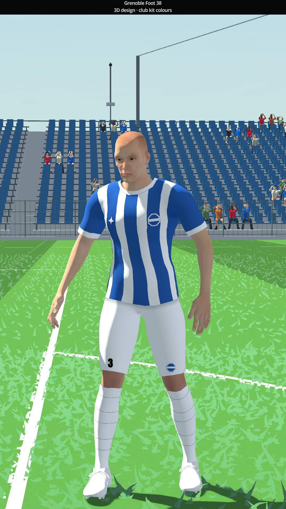
  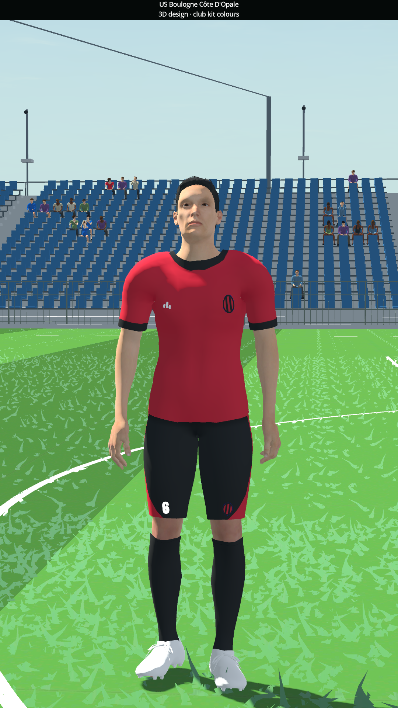

Stadiums bring together stands, corners, seating, roofs, floodlights, scoreboards,
advertising and their surroundings. Custom teams, kits and grounds can be created
and shared with the separate No9Editor application.
Parking grows in compact blocks of paired rows as larger grounds need more spaces.
Grounds use researched capacities where available and generated capacities for
undocumented venues. Their initial layout grows from a small stand to stands on
all four sides and connected corner sections. Generated seats take the home
club's primary colour, or the owning federation's primary colour at a national
ground. Documented locations guide village, town/city and metropolitan settings,
with plains/coast or hills/mountains where the geography can be classified.

## Create your football world with No9Editor

  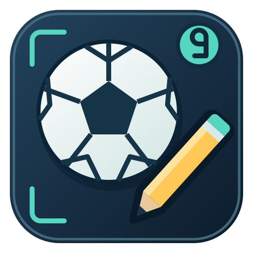

### A standalone editor for clubs, kits and stadiums

**Windows 64-bit · British English and Romanian · Portable projects and data packs**

[Explore No9Editor](docs/EDITOR.md) · [Download No9Editor 1.2.43](https://github.com/florinhangu/Footballer/releases/download/no9editor-v1.2.43/No9Editor.exe)

  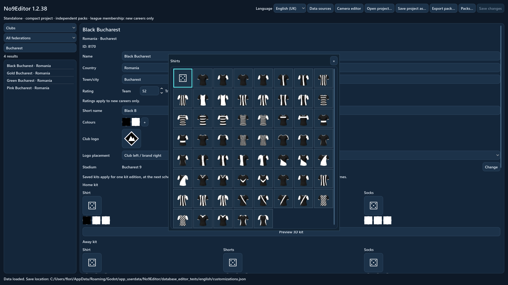
  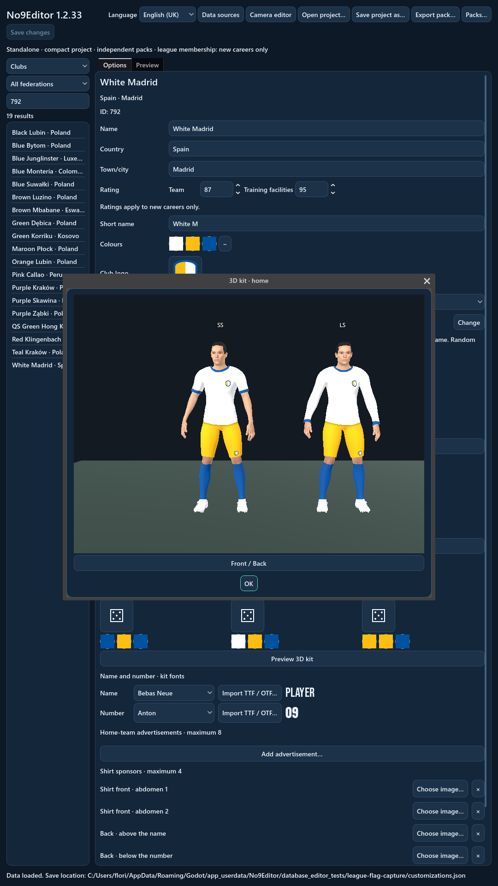

Edit club and federation identities, design each garment, choose kit-printing
fonts and build stadiums in a live 3D preview. Save your work as a project or
export a data pack for the game. No9Editor runs as its own application, with its
own included database; installing Godot is unnecessary.

## Get No9

**No9Editor for Windows is available to download.**
[Download No9Editor 1.2.43](https://github.com/florinhangu/Footballer/releases/download/no9editor-v1.2.43/No9Editor.exe)
or see [download details](docs/RELEASES.md).

A public game build is not available from this repository. The images above show
the actual game and its playable scenes.
