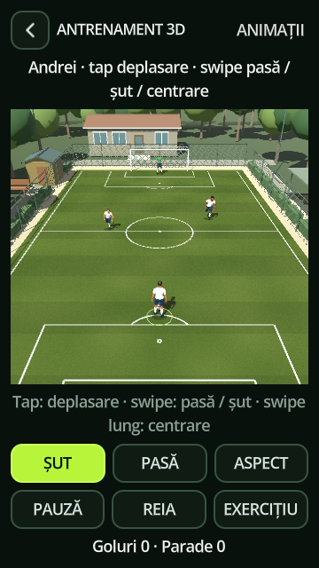
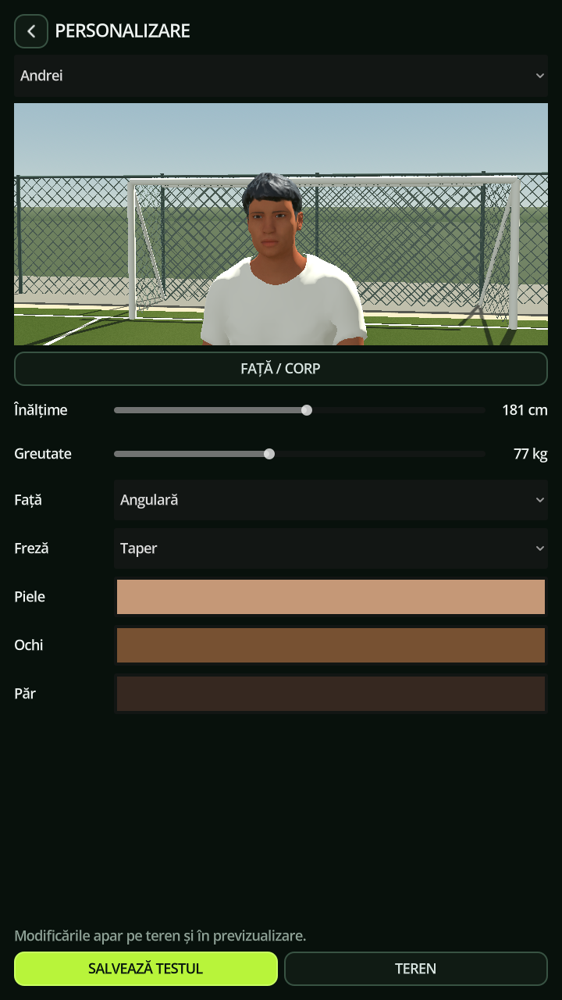
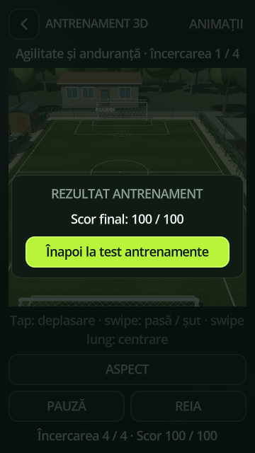

# No9: Day One
### Your first trial. Your first contract. Your story on the pitch.

**A football career begins with a chance.**

Offline player career · Mobile-first controls · Tactical match simulation · Native 3D training

[Explore the game](#a-career-with-your-name-on-it) · [Controls](#take-control) · [Development status](#what-you-can-play-today) · [Builds](https://github.com/florinhangu/Footballer/releases) · [Test notes](docs/VERIFICATION.md)

*An existing development capture of the premium training facility. Screenshots throughout this page show real project scenes and interfaces; they are not promotional renders. Captures can predate the latest camera, lighting or kit adjustments. The current interface shown is Romanian; this presentation is English.*

## A career with your name on it

You are the footballer. You create your identity, choose your position and career country, attend trials and work toward your first club contract. Then the weeks begin to matter: training, recovery, the next fixture and the place you are trying to earn in the team.

**No9: Day One** connects the small decisions of a player's week with a wider football world. Clubs play through seasons, tables move, cups advance, teams fight for promotion and international qualification opens new routes. Your career is saved locally.

The project combines an established **2D career-match experience** with an expanding **native 3D training and match laboratory**. The 3D view uses real meshes, skeletons, materials and Godot scenes, with an oblique portrait camera and movement on the pitch plane.

<table>
<tr><th>Your first opportunity</th><th>The match</th><th>Native 3D training</th></tr>
<tr>
<td></td>
<td></td>
<td></td>
</tr>
</table>

## What you can play today

This is an actively developed alpha project. The table describes the source snapshot reviewed on **12 October 2026**, rather than guaranteeing that every earlier APK includes every feature.

| Area | Current implementation | Status |
| --- | --- | --- |
| Player career | Player creation, trials, club contracts, weekly progression, attributes, history, local saving and trophies | Existing career flow |
| Football world | Domestic leagues, cups, calendars, tables, promotion/relegation and international competitions | Implemented, with country-specific adaptations |
| 2D matches | Shared football rules, AI decisions, ball movement, restarts, referee events, score and clock | Existing career presentation |
| Career training | Canonical interactive exercises and the career energy/reward flow | Implemented separately from the 3D tests |
| 3D training | All 20 canonical exercises, briefings, four attempts, scoring and a free-training sandbox | Playable test area |
| 3D demonstrations | Small-sided 5+1 and full-size 11v11 matches, native actors, cameras, referee and substitutions | Playable test area |
| 3D official-match integration | A fixture entry point and a completed-match result signal use the shared authority | Integration path exists; full career UI/result persistence must be verified |
| Appearance and animation | Humanizer-based avatars, body/face controls, kits and a native showcase library | Implemented; visual and device verification continues |
| Android | APK export configuration for ARM32 and ARM64, portrait interface | Target platform; current 3D performance is not certified |
| iOS | Mentioned in the original public repository description | No verified export preset or release in the reviewed snapshot |

**The 3D laboratory does not automatically award career training points or write demonstration scores into your career.** Those flows remain separate.

## A football world that keeps moving

The game's existing catalog documentation reports **152 associations with domestic competitions**, **6,349 playable clubs in active leagues**, **7,879 clubs including inactive promotion reserves**, and **211 FIFA national-team federations**. These are documented project counts, not a new independent database recount.

The career includes domestic league and cup structures alongside continental club competitions and national-team tournaments. Countries can use round-robin seasons, regional groups, championship/relegation splits and promotion play-offs. The calendar is adapted to the game's 60-week career season.

**Competition rules are the rules implemented by No9.** Some formats deliberately differ from real-world editions. Club names and catalog research do not imply endorsement or official licensing.

Examples include Romania's multi-level pyramid, Argentina's separate tournament phases, Moldova's mixed qualification group, Australia's league/finals arrangements and regional New Zealand competitions. The focus is a career world with meaningful progression, rather than one identical league template applied everywhere.

## One match authority, two ways to see the game

The current **AuthorityEngine** owns football decisions and results for both 2D and authoritative 3D matches. The 3D adapter converts normalized match coordinates into the dimensions of the selected ground and presents the same official state.

Its responsibilities include:

- Team positioning, support, pressing, movement and action selection.
- Possession, passing, crossing, shooting and ball trajectories.
- Goals, touchlines, corners, goal kicks, free kicks, penalties and offside.
- Fouls, cards, restarts, half-time, changing ends and substitutions.

The native 3D presentation adds animated players, goalkeeper actions, jersey identities, a referee, a fourth official with a substitution board, occupied benches, entrances and celebrations. Broadcast and ball-follow cameras frame the action.

The full-size test pitch measures **105 × 68 m**, with **7.32 × 2.44 m** goal openings. Current match configuration uses **90 real seconds per half**; the 3D match tests set the engine tempo to **1.75×**. These are game settings, not real match duration.

A deliberate interaction rule freezes live play while the human-controlled player holds possession and stands still. This gives touch players time to choose their next action.

## Train the footballer you want to become

The native test catalog reuses the existing exercise definitions and scoring instead of creating a second reward system.

| Focus | Exercises |
| --- | --- |
| Ball technique | Ball control and running, passing, shooting, crossing, control and dribbling |
| Movement | Running and sprinting, getting free and positioning, agility and endurance |
| Combinations | Attacking combination, passing combination, through balls and direction changes, run–get free–shoot |
| Set pieces | Corners, penalties, free kicks, free-kick crosses |
| Duels and aerial play | Tackling, interception and tackling, aerial play, heading from a cross |

Each exercise has a briefing, four attempts and a final score from 0 to 100. The free-training area adds a goalkeeper and optional animation tests. Catalog drills build their own required players and equipment; goalkeeper presence follows the original drill definition.

<table>
<tr><th>Make the player yours</th><th>See the result of an exercise</th></tr>
<tr>
<td></td>
<td></td>
</tr>
</table>

*The 100/100 image is one captured test result, not a typical-score claim.*

Training grounds range from compact single-pitch facilities to larger academy, performance and premium layouts. The project also has urban and mountain stadium variants. Facilities, paths, vegetation, fences and goals give practice a setting beyond an isolated rectangle of grass.

## Take control

| Context | Input | Action |
| --- | --- | --- |
| Touch / pointer | Tap or click the pitch | Move the controlled player; dribble when in possession |
| Touch / pointer | Swipe toward a teammate | Pass |
| Touch / pointer | Long swipe toward a teammate | Aerial cross / longer delivery |
| Touch / pointer | Swipe toward the goal | Shoot; aim and gesture affect the free-training trajectory |
| 2D match | Tap an opponent within the relevant duel context | Attempt a challenge |
| 3D free training | **ȘUT / PASĂ** | Optional shoot/pass buttons |
| Desktop 3D test | WASD / arrow keys | Move |
| Desktop 3D test | Shift / Space / P / R | Faster movement / shoot / pass / reset |
| 3D laboratory | **PAUZĂ / CONTINUĂ / REIA** | Pause / resume / restart |
| Demo match | **PREIA CONTROLUL / AI LA AMBELE** | Take control / return both teams to AI |

Button names above match the Romanian interface in the current captures. Controls are context-dependent; desktop shortcuts describe the 3D laboratory.

## From GameCore to Day One

**Created and directed by Florin Hangu, with AI-assisted implementation, research and iteration.**

The preserved Git history begins on **26 September 2026**. An initial repository commit was followed that day by the **“Initial No9 GameCore repository”** import and integration of the two histories. The available record does not establish when the idea or work before Git began.

The early recorded development concentrated on the tactical foundation: shared world state, coordinated rotations, passing shadows, curved pressure, progression options and reactions to opponents. The project then expanded through club catalogs and competition structures, equipment and character experiments, native training, and the current 3D match presentation.

| Recorded period | Direction of development |
| --- | --- |
| 26 September | GameCore enters Git; tactical context and collective AI work appear in the history |
| Late September – early October | Modular equipment, imported character/animation experiments, stadium corrections and competition research |
| 7–9 October | Character presentation work, native training catalog, editable previews and appearance controls |
| 10–11 October | 3D match demonstrations, shared rules authority, benches, officials, loading and camera iteration |
| 12 October | Footballer becomes the English public presentation and future build-download hub |

Progress has been substantial, but iteration has also exposed regressions: incompatible model assumptions, weakened historical tests, visible loading stalls and animation/camera changes that need narrower verification. The current direction is to preserve a working baseline and verify one focused change at a time.

## What the simulations have shown

These are **previously documented desktop results**, not tests rerun for this public page, and not Android acceptance results.

| Recorded test scenario | Reported outcome |
| --- | --- |
| Autonomous 3D demo, 10 October, 90 seconds | 31 passes, 15 shots, receptions and tackles on both feet, eight ground distributions; **1–1** |
| Official-AI demo, 11 October, 90 seconds | 11 passes, seven crosses, four shots, 14 headers, 12 received passes, seven goalkeeper distributions; **1–0** |
| Native animation library comparison | **7,685 checks / 0 failures** in the documented desktop run |
| Shared-authority and presentation checks | **684 focused checks / 0 failures** reported across the documented integration suites |
| Broader tactical / world-state suites | Known failures remained: **25/58** tactical checks and **2/58** world-state checks |

The two demo summaries describe earlier physical-contact test scenarios. The current authoritative presentation is a separate path, and legacy physical tests explicitly select their legacy harness. Their scores should not be treated as evidence that every current match pathway is complete.

A documented GTX 1050 Compatibility-renderer run with 22 players and a native referee measured approximately **29.8 FPS median**, with a **65.757 ms p95 frame time**. A later run under concurrent GPU loading was slower. This is a local development measurement, not a mobile performance promise.

[Read the verification notes and remaining limits →](docs/VERIFICATION.md)

## Built with

| Component | Role |
| --- | --- |
| **Godot 4.7 / GDScript** | Game scenes, UI, career systems, rules, simulation and rendering; development notes reference Godot 4.7.2 |
| **Compatibility renderer** | Current project and mobile rendering configuration |
| **Humanizer / MakeHuman-based assets** | Current avatar geometry, skeletons, appearance and equipment pipeline |
| **Native Godot animation and procedural poses** | Movement, football actions, grounded motion and the 66-clip showcase |
| **Local Tabler SVG icons** | Primarily filled navigation and UI icons, without a runtime CDN |
| **Project-made geometry and shaders** | Editable grounds, facilities, grass, nets, ball trails and presentation |
| **Terrain3D and environment tools** | Outer scenery; ARM Android binaries are present, while device validation remains necessary |
| **Quaternius Stylized Nature MegaKit** | A retained compatible third-party nature asset set; inclusion does not mean every asset is used in every scene |

The project also contains editor tools for roads, layered materials, rich 3D text, ragdolls and low-poly terrain. Presence in the repository or editor plugin list does not establish a runtime feature.

[Asset acknowledgements and license notes →](docs/CREDITS.md)

## Beyond the scoreboard — the No9 promise

**This is our editorial north star, not a list of completed features.**

A compelling player career should make an ordinary Tuesday feel connected to Saturday's match. A training result should explain something about your footballer. A new club should feel like a new chapter, and a substitution should still make sense when the camera is close enough to see the people involved.

Three principles guide that experience:

**Earn your place.** Build the story through preparation, performances and opportunities.

**Make football readable.** Use clear touch controls, visible movement and coherent rules so a player understands what happened.

**Let the world remember.** Preserve the consequences of matches, contracts and seasons as the career grows.

This is the standard against which new features should be judged: do they make your footballer's next week more meaningful?

## Builds and getting started

**Public download hub:** [Footballer Releases](https://github.com/florinhangu/Footballer/releases).

At the publication check, this repository had **no published release or attached APK**. No binary has been uploaded as part of this presentation.

The private game's Android export preset currently names **0.A1.33**, while its application configuration still names **0.A1.16**. Those values need reconciliation before a release is presented as a verified build. A preset filename alone is not proof that an APK was built or tested.

Once a build is published, its release notes should identify the exact version, tested devices, included modes, known issues and save compatibility. See the [release guide](docs/RELEASES.md).

A good first session: create a footballer, open the next trial, explore the club/calendar pages, and try the 3D training catalog separately. Your career and the laboratory have different progression rules.

## Help shape the next week

Useful feedback is specific: the build version, device, game mode, action taken, expected result and what actually happened. Add a screenshot or short clip when it explains a visual issue.

[Report an issue](https://github.com/florinhangu/Footballer/issues) · [Browse public builds](https://github.com/florinhangu/Footballer/releases)

---

**Your first contract is only the beginning.**

*This repository is the public presentation and release hub for No9: Day One. It does not publish the private game source. Presentation reviewed against the game source snapshot dated 11 October 2026; public page prepared 12 October 2026.*
