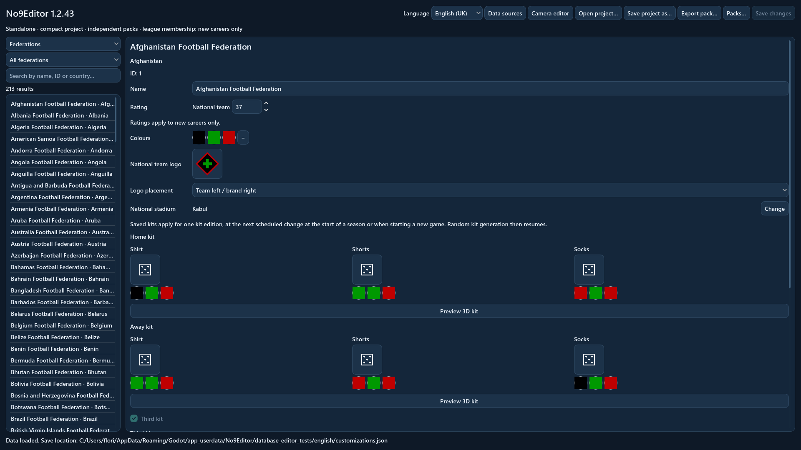
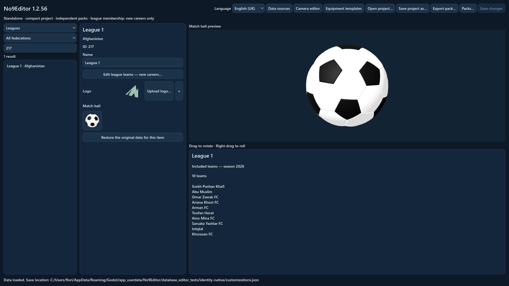
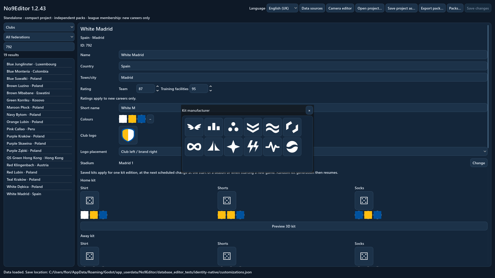
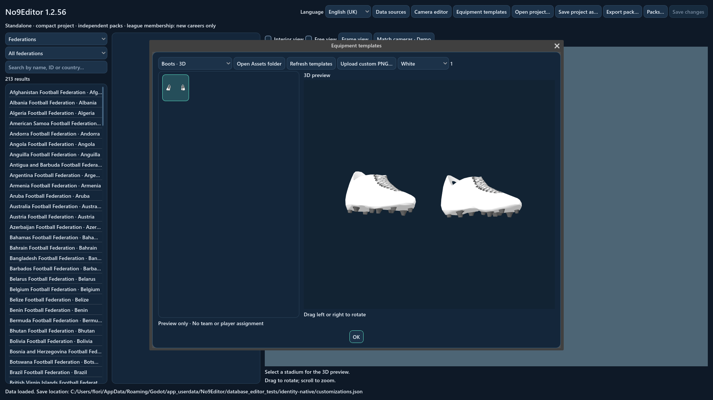
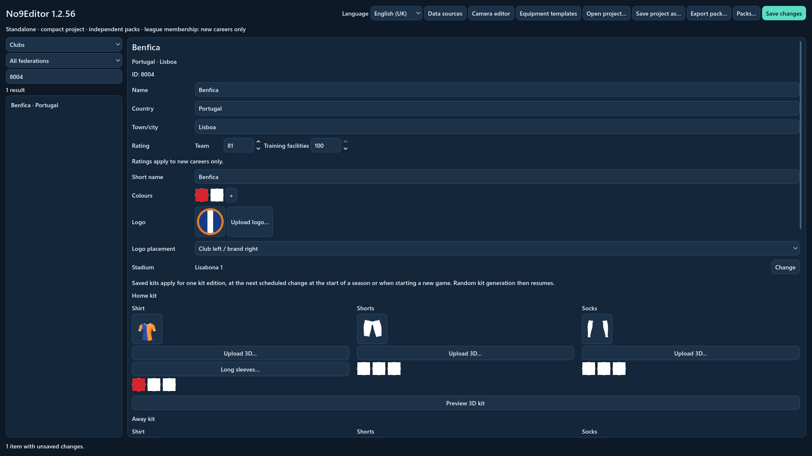
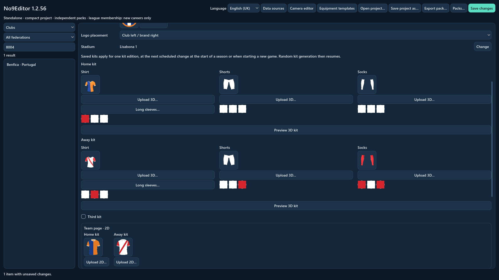
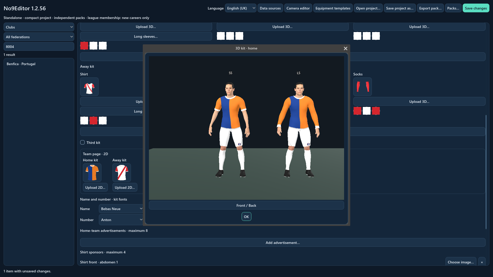
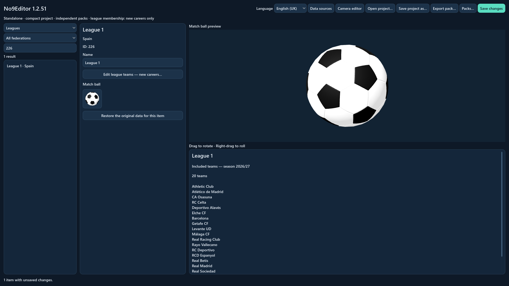
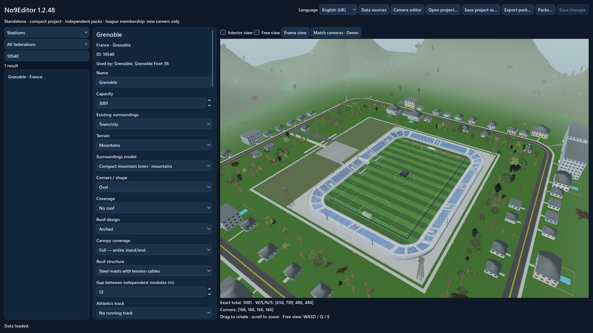
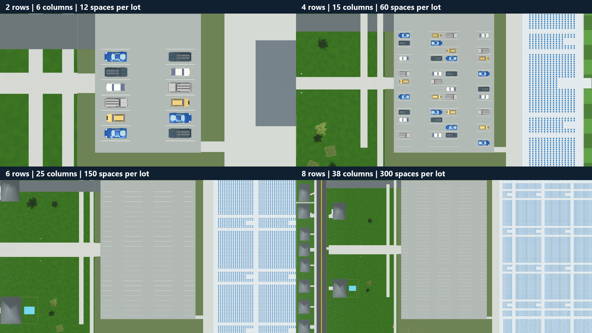

# No9Editor

### Make the football world your own.

**Clubs · Federations · Kits · Stadiums · Shared data packs**

[Download 1.2.56 for Windows 64-bit](https://github.com/florinhangu/Footballer/releases/download/no9editor-v1.2.56/No9Editor.exe) · [Download details](RELEASES.md) · [No9: Day One](../README.md)

No9Editor is a **separate standalone Windows application** for creating and
sharing football data for No9: Day One. Open a single executable and work with
the included database. Godot and the game do not need to be installed beside it.

## Give every team an identity

Edit club and federation names, ratings, identity colours and stadium assignments.
Search for teams and grounds, work with league names and membership, and consult
the competition regulations as you build your project.

The interface is available in **British English and Romanian**, with a language
selector that remembers your choice. Each language has its own catalogue. Club
and stadium names remain editable, alongside separate town/city and country fields.

| Your creation | What you can choose |
| --- | --- |
| Clubs | Names, short names, ratings, colours, stadiums, kits and branding |
| Federations | Names, national-team ratings, colours, national stadiums and kits |
| Leagues | Names, membership for new careers and a separate match ball |
| Competitions | Names, a separate match ball and readable regulations for reference |
| Stadiums | Capacity, structures, seating, covering, equipment and surroundings |

## Choose a crest

Browse **84 original crests**, combining seven outlines with twelve shared
patterns, including stripes, a star, a tree, a cross, mountains and quartered
squares. Every thumbnail uses the selected team colours.

The **primary colour fills the crest**, the **secondary colour fills its symbol**,
and the **third colour outlines its border**. With two colours, the border
uses the secondary colour. Clubs and national teams each start with a default
crest on the left chest. A central layout places the club crest above the
manufacturer mark; the shorts carry the crest opposite the number.

National federation palettes use **up to three dominant country-flag colours**.
Federations are named **Country Football Federation**. Domestic leagues use
numbered tiers and lettered groups in the selected language. International
competitions use full organisation names, with compact labels where space is
limited. Public authors can edit names without publisher licensing controls.

  
  
   
  
  

## Design the complete kit

Choose a model for the **shirt, shorts and socks** from their visual galleries.
Set each garment's colours independently, then view the complete kit from the
front or back. Home, away and third kits each have their own choices.

Name and number printing have separate font selections. Use a bundled font or
import a TTF/OTF font for your design. Club sponsors, manufacturer logos and
pitchside advertising can be included in the team's identity.

Choose from **twelve original manufacturer symbols**, including wings, an infinity
loop, waves, sails and geometric marks. Clubs and national teams receive stable
default marks, while your own imported artwork remains available. Place the team
crest and manufacturer on opposite sides of the chest or stack them centrally.

  

  
  
   
  
   
  

## Design galleries and previews

Every selected 3D shirt, pair of shorts and pair of socks appears inside its
**72 × 72 selection button**. Upload 3D stays beside the garment controls.
Default kits use varied models selected from the game's catalogue.

A separate **Team page · 2D** panel sits below the home, away and optional third
3D kits. Its short-sleeved shirts appear side by side in **72 × 72** tiles, each
with an Upload 2D button. The 2D design follows the selected 3D shirt automatically;
short- and long-sleeved 3D shirts share one 2D shirt identity.

**Equipment templates** shows artwork created by the user and designs included
in imported packs. The standard boot catalogue also remains available. Club and
competition forms can still choose their appropriate built-in game designs.
UV references and PSD authoring files are excluded from playable galleries.

Rotate the ball on all three axes. Shirts, shorts, socks and boots turn left or
right through 360 degrees, with the camera fixed. Boot previews use the same mesh,
skin and idle pose as the match, with increased rendering resolution and a fitted
view that keeps both boots in frame.

  

## Bring your own artwork

The application uses **Assets** beside its executable, with no separate Custom
folder. It includes six UV guides, a short-sleeved 2D shirt PSD and a separate
overlay. No Godot installation is needed.

| Artwork | Folder inside Assets |
| --- | --- |
| Team-page shirt | Kits/2D_Kits/Shirt |
| Short-sleeved shirt | Kits/3D_Kits/SS_Shirt |
| Long-sleeved shirt | Kits/3D_Kits/LS_Shirt |
| Shorts | Kits/3D_Kits/Shorts |
| Socks | Kits/3D_Kits/Socks |
| NOVE ball | Ball/3D |
| Boots | Boots/3D |

Team uploads are saved by numeric identity: **8004_home.png**, **8004_away.png**
and **8004_third.png**, in the corresponding category folder. League and competition
ball uploads use their numeric ID. Renaming a team does not rename its artwork.

Custom PNGs keep their colours and any logos, sponsors or manufacturer marks
already drawn into them. Automatic shirt branding is suppressed; player names
and numbers still follow the printing choices. Authored kits last for one normal
kit edition, starting with a new career or the next scheduled replacement.

Clubs, federations, leagues and competitions each have a visible **Upload logo…**
button. League and competition forms display their existing SVG emblem by default.
Custom PNG, JPEG, WebP or SVG logos remain until explicitly removed.

Save a **.no9project** or export a **.no9pack** to embed your artwork. Include
unassigned custom templates when sharing a collection. Recipients need only the
project or pack, rather than the author's original image files.

  
   
  
   
  

## Choose the match ball

Give each league and competition its own ball, including national cups. Open the
visual gallery to choose a playable design, or use the standard black-and-white
NOVE ball. UV reference sheets are kept out of the selection.

Inspect the selected ball in a **separate 3D preview**. Drag to rotate it freely;
right-drag rotates the third axis. The camera stays fixed. Each competition’s
choice travels with its data pack and is used in that competition’s 3D matches.
Training and friendlies use the standard ball.

  
   
  

## Build a ground for your club

Shape the stadium in a **live 3D preview**. Choose stands and corners, seat
colours and patterns, tiers, roofs and supports. Set capacity and add match-day
equipment such as dugouts, floodlights, scoreboards and advertising.
Spectator stair flights share a 1.25 m width across stands, end stands, corners
and rear access.

Reference records include researched capacities and separate physical stadium
identities for shared grounds. Where a capacity is undocumented, the catalogue
provides a generated value. Generated seating follows the home club's primary
colour, or the owning federation's primary colour at a national ground.
You can set your own capacity, colours and design; authored choices take priority.

Documented geography provides an initial village, town/city or metropolitan
setting and plains/coast or hills/mountains. Metropolitan defaults use urban
centres with at least one million residents. Choose the surrounding environment
and inspect the result with rotation, zoom, free view and an interior view.
Stadium configurations travel with your data
pack and can appear in the game's 3D matches.

Larger parking requirements add pairs of rows and more columns, keeping each lot
compact and rectangular, with clear access aisles.

  
   
  

## Save it. Share it. Play with it.

Save a portable **`.no9project`** to reopen your work on another PC. Export a
**`.no9pack`** to share the selected clubs, kits, grounds and included images or
fonts. Players import packs in the game and choose which ones to activate.

Changes to different fields can be combined. Where packs offer different values
for the same field, the player chooses their priority.

New careers can use activated packs from the start. Existing careers apply
presentation changes at the next season boundary. League membership and initial
ratings apply to new careers only. An authored kit is used for one normal kit
edition, following the team's usual annual or two-season cycle, before the
game's normal kit generation resumes.

Custom artwork screenshots show **No9Editor 1.2.56**. Other screenshots illustrate the existing editor tools.

## Download No9Editor

**Windows 64-bit · Single executable · Approximately 570 MiB**

[Download No9Editor.exe](https://github.com/florinhangu/Footballer/releases/download/no9editor-v1.2.56/No9Editor.exe)
and open it to start a project. The application includes its runtime, database
and assets. See [download details](RELEASES.md) for the current version and checksum.
