

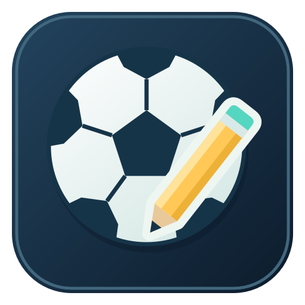

# No9Editor

### Make the football world your own.

**Clubs · Federations · Kits · Stadiums · Shared data packs**

[Download for Windows 64-bit](https://github.com/florinhangu/Footballer/releases/download/no9editor-v1.2.33/No9Editor.exe) · [Download details](RELEASES.md) · [No9: Day One](../README.md)

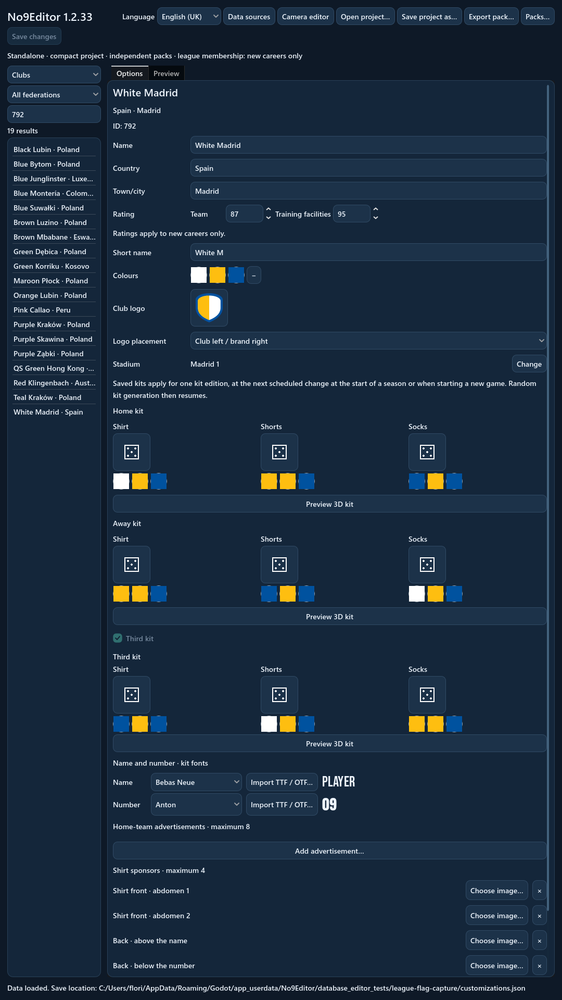

No9Editor is a **separate standalone Windows application** for creating and
sharing football data for No9: Day One. Open a single executable and work with
the included database. Godot and the game do not need to be installed beside it.

## Give every team an identity

Edit club and federation names, ratings, identity colours and stadium assignments.
Search for teams and grounds, work with league names and membership, and consult
the competition regulations as you build your project.

The interface is available in **British English and Romanian**, with a language
selector that remembers your choice. Each language has its own catalogue. Club
and stadium names remain editable, alongside separate town/city and country fields.

| Your creation | What you can choose |
| --- | --- |
| Clubs | Names, short names, ratings, colours, stadiums, kits and branding |
| Federations | Names, national-team ratings, colours, national stadiums and kits |
| Leagues | Names and membership for new careers |
| Competitions | Names, with readable regulations for reference |
| Stadiums | Capacity, structures, seating, covering, equipment and surroundings |

## Choose a crest

Browse **84 original crests**, combining seven outlines with twelve shared
patterns, including stripes, a star, a tree, a cross, mountains and quartered
squares. Every thumbnail uses the selected team colours.

The **primary colour fills the crest**, the **secondary colour fills its symbol**,
and the **third colour outlines its border**. With two colours, the border
uses the secondary colour. Clubs and national teams each start with a default
crest on the left chest. A central layout places the club crest above the
manufacturer mark; the shorts carry the crest opposite the number.

National federation palettes use **up to three dominant country-flag colours**.
Federations are named **Country Football Federation**. Domestic leagues use
numbered tiers and lettered groups in the selected language. International
competitions use full organisation names, with compact labels where space is
limited. Public authors can edit names without publisher licensing controls.

  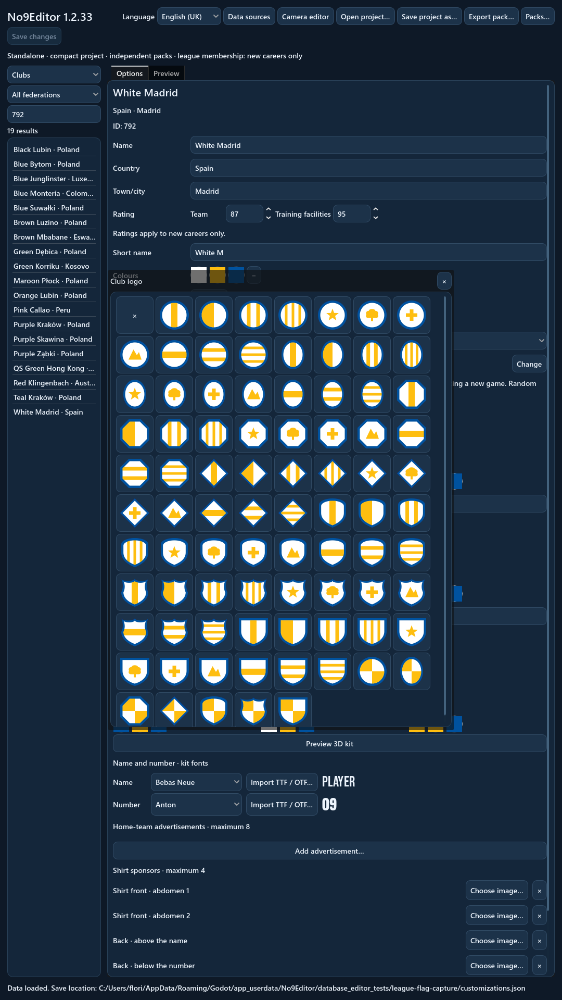
  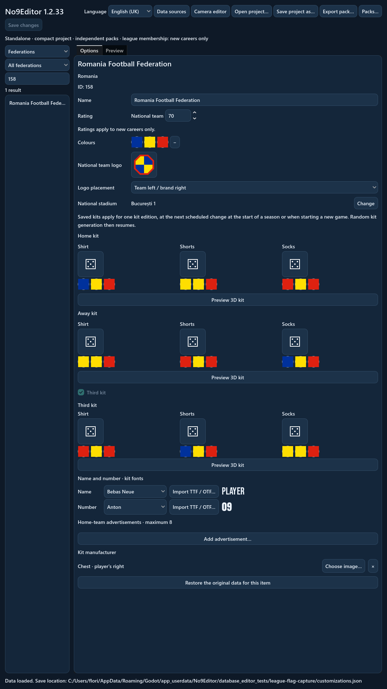
   
  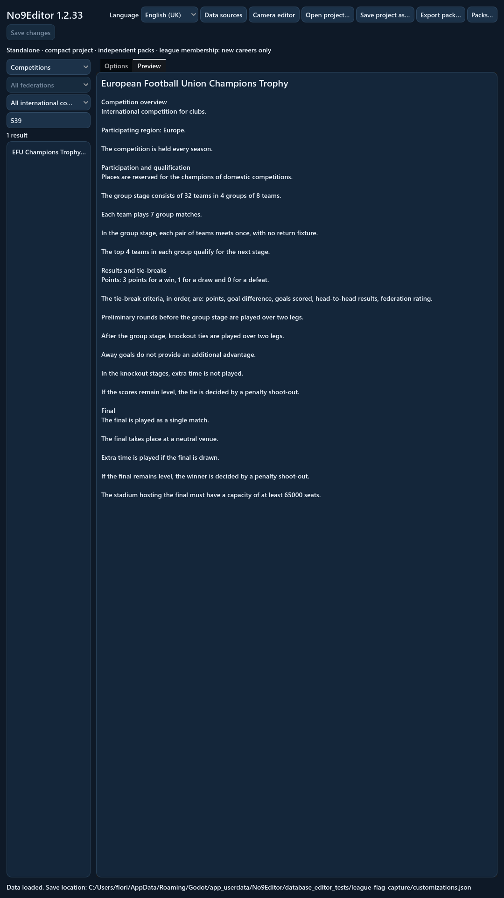
  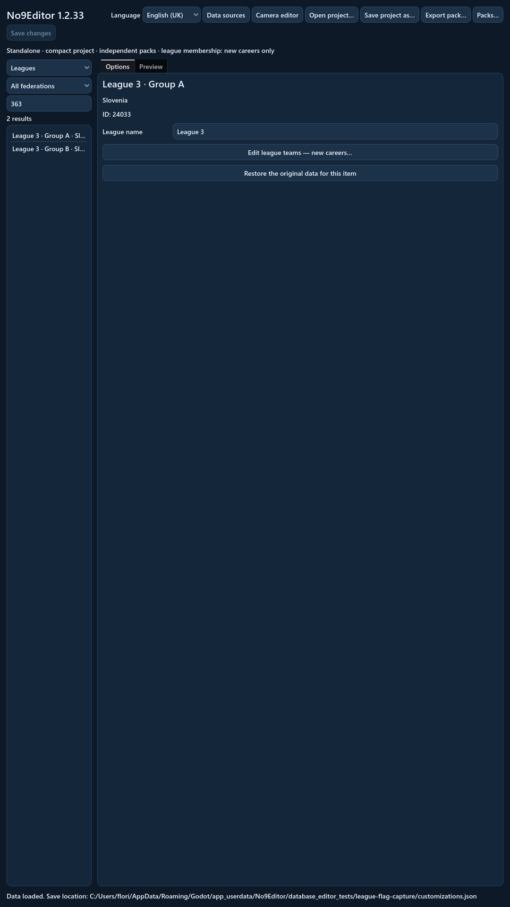

## Design the complete kit

Choose a model for the **shirt, shorts and socks** from their visual galleries.
Set each garment's colours independently, then view the complete kit from the
front or back. Home, away and third kits each have their own choices.

Name and number printing have separate font selections. Use a bundled font or
import a TTF/OTF font for your design. Club sponsors, manufacturer logos and
pitchside advertising can be included in the team's identity.

  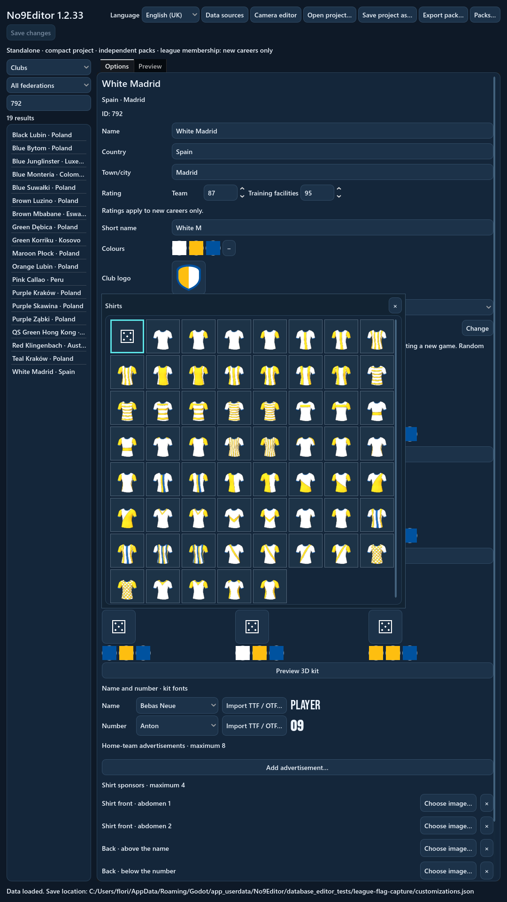
  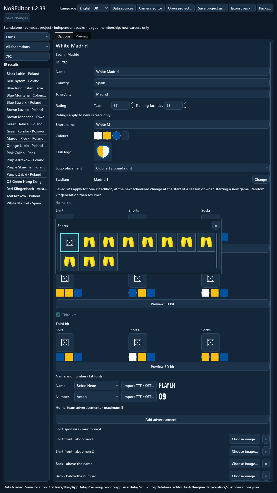
   
  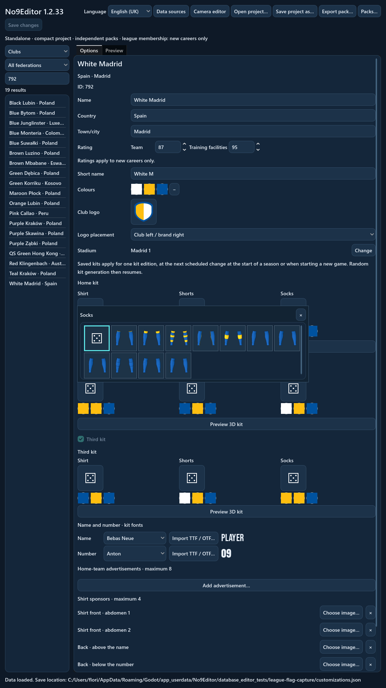
   
  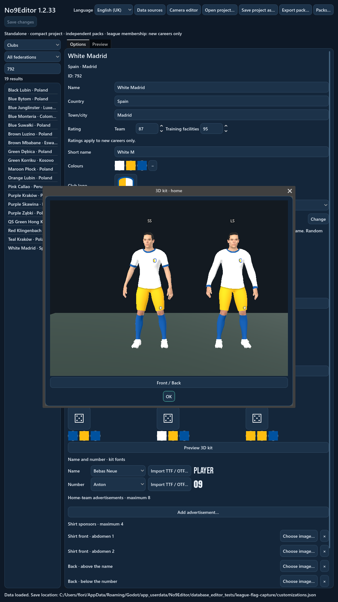

## Build a ground for your club

Shape the stadium in a **live 3D preview**. Choose stands and corners, seat
colours and patterns, tiers, roofs and supports. Set capacity and add match-day
equipment such as dugouts, floodlights, scoreboards and advertising.

Choose the surrounding environment and inspect the result with rotation, zoom,
free view and an interior view. Stadium configurations travel with your data
pack and can appear in the game's 3D matches.

  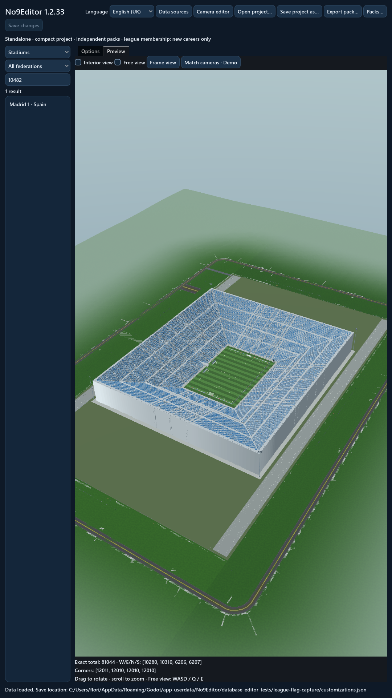

## Save it. Share it. Play with it.

Save a portable **`.no9project`** to reopen your work on another PC. Export a
**`.no9pack`** to share the selected clubs, kits, grounds and included images or
fonts. Players import packs in the game and choose which ones to activate.

Changes to different fields can be combined. Where packs offer different values
for the same field, the player chooses their priority.

New careers can use activated packs from the start. Existing careers apply
presentation changes at the next season boundary. League membership and initial
ratings apply to new careers only. An authored kit is used for one normal kit
edition, following the team's usual annual or two-season cycle, before the
game's normal kit generation resumes.

## Download No9Editor

**Windows 64-bit · Single executable · Approximately 551 MiB**

[Download No9Editor.exe](https://github.com/florinhangu/Footballer/releases/download/no9editor-v1.2.33/No9Editor.exe)
and open it to start a project. The application includes its runtime, database
and assets. See [download details](RELEASES.md) for the current version and checksum.
